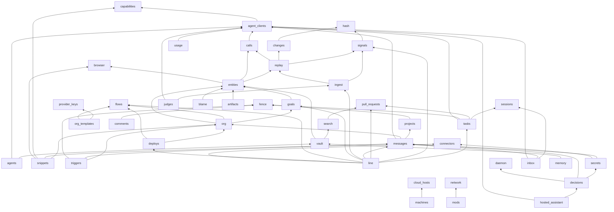

# Splitting `contracts` and the shared core into packages

Status: adopted, not started. Computed on `main` at `0a2b5eb53` with the docs and chat, comments, blame and artifacts, and agents, memory and vault extractions applied, so `chat`, `docs`, `comments`, `blame`, `artifacts`, `agents`, `memory` and `vault` count as packages already. Several small packages from one wave may land in one PR, one commit per package.

The short version:

- **No module cycle crosses a folder.** Every cycle between `contracts`, `tasks`, `entities`, `render`, `replay` and `changes` is a folder-level cycle made of one-way module chains. Placing modules correctly is enough to untangle them. Only one symbol split is needed: the FNV hash helpers in `inboxProjection`.
- Inside `contracts` there are exactly 5 module cycles, each with 2 or 3 modules. Each moves as one unit.
- The `contracts` barrel is not a side issue. **1,113 files import `@codecast/shared/contracts` bare**, and 95 of the 105 modules it re-exports have no subpath export at all. Every move PR therefore rewrites barrel importers too. The counts below include them.
- The target is 48 domain packages: 44 new ones, plus 4 existing packages (`mods`, `network`, `vault`, `agents`) that take in modules. There are 8 waves of PRs after one prep wave (W0), 61 PRs in all. Every PR rewrites 150 or fewer importers. The `agentClients` cycle alone would be 211, so it is staged across two PRs (see W2).

The scripts and inputs are in `docs/architecture/contracts-split/`:

| File         | What it does                                                                                                                                                                                                                                          |
| ------------ | ----------------------------------------------------------------------------------------------------------------------------------------------------------------------------------------------------------------------------------------------------- |
| `graph.ts`   | Parses every import specifier with the TypeScript parser. That includes static imports, `export … from`, `import()`, `require`, `mock.module` and `import("…").T` type queries. It resolves `@codecast/shared/*` through the package's `exports` map. |
| `analyze.ts` | Builds the module graph, the strongly connected components (SCCs), the fan-in, and the barrel-symbol origins.                                                                                                                                         |
| `table.ts`   | Writes the per-module table.                                                                                                                                                                                                                          |
| `check.ts`   | Builds the package graph from `assign.txt` and runs SCC detection on it.                                                                                                                                                                              |
| `plan.ts`    | Validates `waves.txt`: deps land in an earlier wave, nothing is planned twice, and it counts the importers of each PR.                                                                                                                                |

To re-run all of it: `bun graph.ts <tree> edges.json && bun analyze.ts <tree> edges.json report.json && bun table.ts <tree> && bun check.ts && bun plan.ts`.

## 1. The graph

### 1.1 Size

| Folder      | Source modules                             | Test files | Notes                                                                |
| ----------- | ------------------------------------------ | ---------- | -------------------------------------------------------------------- |
| `contracts` | 246, plus `index.ts` and 3 fixture modules | 186        | 241 top-level modules and 5 under `evalsApi/`                        |
| `entities`  | 1 (`index.ts`, 1,646 lines)                | 4          |                                                                      |
| `tasks`     | 13                                         | 11         | `tasks/index.ts` is a barrel **and** holds 418 lines of its own code |
| `render`    | 17, plus `css-tree.d.ts`                   | 9          |                                                                      |
| `replay`    | 11, plus `mobile.fixture.ts`               | 9          |                                                                      |
| `search`    | 4                                          | 3          |                                                                      |
| `changes`   | 11, plus 3 fixtures                        | 9          |                                                                      |
| `ratchet`   | 1                                          | 3          | Also holds 2 baseline files                                          |

2,203 files outside `packages/shared` import something from `contracts`. 1,255 of them use a subpath, 1,113 use the barrel, and 164 use both.

### 1.2 Folder cycles and the exact edges behind them

These are all the non-test edges that cross folders.

| From                                                                         | To                                                                                                                |
| ---------------------------------------------------------------------------- | ----------------------------------------------------------------------------------------------------------------- |
| `contracts/linePriority`                                                     | `tasks/index` (the `TaskPriority` type, defined in `tasks/statuses`)                                              |
| `contracts/superseded`                                                       | `tasks/statuses` (`isTerminalTaskStatus`)                                                                         |
| `contracts/initiative`                                                       | `entities/index` (`parseEntityUrl`), and `@codecast/chat/handles`                                                 |
| `contracts/orgProposalReply`                                                 | `entities/index` (`proposalChangeRefId`)                                                                          |
| `contracts/callRoomKeys`                                                     | `@codecast/chat/dm` and `@codecast/team/memberKind`. These are packages already, so they make no cycle.           |
| `entities/index`                                                             | `contracts/browserPaneOffer`, `callLinks`, `callRecordings`, `replayPlayer`, and `replay/events`                  |
| `tasks/index`                                                                | `contracts/agentClients` (`isHostedAgentType`)                                                                    |
| `tasks/foreignText`, `planForeignText`, `resume`                             | `contracts/fence`                                                                                                 |
| `tasks/graph`                                                                | `contracts/prRefs`                                                                                                |
| `tasks/planState`                                                            | `contracts/workState`                                                                                             |
| `render/changeCardHtml`                                                      | `contracts/changeCard` (the only render module that imports `contracts`)                                          |
| `search/sessionQuery`                                                        | `contracts/prRefs`                                                                                                |
| `replay/{capture,dom,events,issues,list,mobile,moment,repro,rrweb,timeline}` | `contracts/replay`                                                                                                |
| `replay/dom`                                                                 | `contracts/replayPlayer`                                                                                          |
| `replay/issues`                                                              | `contracts/signalFingerprint`                                                                                     |
| `replay/moment`, `replay/timeline`                                           | `changes/headline` (`clip`)                                                                                       |
| `changes/keys`                                                               | `contracts/inboxProjection` (`fnv1a32Update`, `FNV1A32_OFFSET`)                                                   |
| `contracts/signalFingerprint`                                                | `contracts/inboxProjection` (`fnv1a32`). This is internal to `contracts`, but it decides where `signals` can sit. |

These test edges cross folders:

| From                                           | To                                    | Note                             |
| ---------------------------------------------- | ------------------------------------- | -------------------------------- |
| `contracts/changeCard.test`                    | `render/changeCardHtml`               | It imports nothing from `tasks`. |
| `contracts/orgProposal.test`                   | `entities` (`parseProposalChangeRef`) |                                  |
| `entities/callMoments.test`                    | `contracts/callLinks`                 |                                  |
| `replay/{issues,list,moment,navs,replay}.test` | `contracts/replay`                    |                                  |
| `replay/mobile.test`                           | `contracts/replayPlayer`              |                                  |
| `tasks/{foreignText,planForeignText}.test`     | `contracts/fence`                     |                                  |

### 1.3 Strongly connected components (module level)

The non-test graph has 306 nodes. **Every SCC is inside `contracts`.** There is none across folders.

| SCC | Members                                            | What closes the cycle                                                                                                      |
| --- | -------------------------------------------------- | -------------------------------------------------------------------------------------------------------------------------- |
| 1   | `agentClients`, `antigravityClient`, `cloudAgents` | Type-only `AgentClientId` imports one way, and value imports (`ANTIGRAVITY_CLIENT`, `CLOUD_AGENT_PROVIDERS`) the other way |
| 2   | `callGuests`, `callRecordings`                     | `recordingKeptWords` one way, `isGuestIdentity`/`markedName` the other                                                     |
| 3   | `agentJudges`, `judges`                            |                                                                                                                            |
| 4   | `envs`, `envCases`                                 |                                                                                                                            |
| 5   | `flowMap`, `lineFunnel`, `lineVolume`              |                                                                                                                            |

Each SCC moves as one unit in one PR. None of them needs a split.

Test files add **package-level** cycles once modules sit in different packages. A test that imports a module in a higher package would make the lower package depend on the higher one. Handling this takes test-only edits to 7 test files in W0. Ten more test files are assigned to a higher package than their name suggests. Section 3 lists both.

### 1.4 Fan-in

Fan-in counts files, after attributing each barrel import to the module that defines the imported name. Columns:

- **out**: importers outside `packages/shared`.
- **in**: non-test importers inside the core folders.
- **tests**: test importers inside the core folders.

The 35 highest:

| Module                    | Lines | out | in  | tests | Where the outside importers are                                                                       |
| ------------------------- | ----- | --- | --- | ----- | ----------------------------------------------------------------------------------------------------- |
| contracts/agentClients    | 1631  | 157 | 11  | 4     | cli 50, mobile 5, server 38, web 63, packages/agents 1                                                |
| entities/index            | 1646  | 124 | 2   | 5     | cli 7, evals 1, mobile 25, server 8, web 79, packages/artifacts 2, packages/blame 1, packages/vault 1 |
| tasks/index               | 460   | 112 | 1   | 4     | cli 17, mobile 8, server 42, web 45                                                                   |
| contracts/machineMessages | 1163  | 94  | 9   | 13    | cli 22, evals 3, mobile 1, server 40, web 28                                                          |
| contracts/initiative      | 1409  | 84  | 5   | 4     | cli 7, mobile 2, server 14, web 61                                                                    |
| contracts/evalsApi        | 34    | 74  | 0   | 1     | cli 2, evals 31, web 41                                                                               |
| contracts/secrets         | 1252  | 69  | 2   | 3     | cli 22, mobile 5, server 11, web 31                                                                   |
| contracts/callRoomKeys    | 365   | 63  | 2   | 3     | cli 1, mobile 9, server 20, web 33                                                                    |
| contracts/changeCard      | 1308  | 61  | 2   | 2     | cli 5, mobile 1, server 14, web 41                                                                    |
| contracts/assistant       | 466   | 61  | 0   | 3     | mobile 4, server 17, web 40                                                                           |
| contracts/orgProposal     | 3709  | 60  | 2   | 6     | cli 7, evals 2, mobile 2, server 9, web 40                                                            |
| contracts/ingest          | 1084  | 60  | 0   | 5     | cli 6, server 28, web 26                                                                              |
| contracts/agentStatus     | 368   | 59  | 2   | 3     | cli 16, mobile 1, server 19, web 23                                                                   |
| contracts/inboxProjection | 1888  | 57  | 2   | 11    | cli 1, server 21, web 35                                                                              |
| contracts/cloudAgents     | 869   | 52  | 2   | 1     | cli 18, mobile 3, server 3, web 28                                                                    |
| contracts/apiErrorBanner  | 652   | 52  | 0   | 6     | cli 21, mobile 1, server 12, web 18                                                                   |
| tasks/statuses            | 268   | 51  | 5   | 1     | cli 4, mobile 1, server 24, web 22                                                                    |
| contracts/orgLead         | 279   | 49  | 3   | 2     | cli 4, evals 1, server 24, web 20                                                                     |
| contracts/snippets        | 2005  | 46  | 1   | 3     | cli 29, web 17                                                                                        |
| contracts/flowPool        | 458   | 44  | 5   | 1     | cli 13, mobile 3, server 7, web 21                                                                    |
| contracts/callGuests      | 543   | 44  | 1   | 1     | cli 1, mobile 3, server 11, web 29                                                                    |
| contracts/callRecordings  | 831   | 43  | 6   | 1     | cli 6, mobile 6, server 14, web 17                                                                    |
| replay/index              | 119   | 42  | 0   | 2     | cli 1, mobile 3, server 17, web 21                                                                    |
| contracts/teamFeatures    | 239   | 40  | 1   | 2     | cli 2, mobile 3, server 9, web 26                                                                     |
| contracts/replay          | 491   | 39  | 11  | 6     | cli 3, server 19, web 17                                                                              |
| contracts/usageLimits     | 818   | 38  | 0   | 1     | cli 7, mobile 2, server 10, web 19                                                                    |
| contracts/prRefs          | 204   | 36  | 3   | 1     | cli 4, mobile 1, server 20, web 11                                                                    |
| contracts/orgAvatars      | 63    | 35  | 3   | 4     | mobile 3, playground 6, server 6, web 20                                                              |
| contracts/decisionAnswers | 158   | 34  | 0   | 3     | server 11, web 20, mobile 3                                                                           |
| contracts/threadState     | 378   | 34  | 0   | 1     | cli 8, mobile 1, server 10, web 15                                                                    |
| search/index              | 40    | 34  | 0   | 1     | cli 1, mobile 4, server 12, web 17                                                                    |
| contracts/convexErrors    | 81    | 33  | 0   | 1     | cli 6, server 2, web 23, mobile 2                                                                     |
| tasks/graph               | 1260  | 32  | 5   | 1     | cli 8, mobile 3, server 9, web 12                                                                     |
| contracts/managedPolicy   | 558   | 32  | 1   | 1     | cli 6, mobile 2, server 6, web 18                                                                     |
| contracts/vaultProtocol   | 409   | 32  | 0   | 1     | packages/vault 2, cli 10, web 20                                                                      |

Nine modules have no importer outside shared: `lineRunEnd`, `antigravityClient`, `approvalAnswers`, `orgProposalReply`, and the 5 `evalsApi/*` internals. Appendix A gives the fan-in of every module, grouped by target package.

### 1.5 Barrel usage

- **Root `@codecast/shared`** (`packages/shared/index.ts`, which is `export * from "./contracts"`): **0 importing files.** Only `package.json` dependency lines name it.
- **`@codecast/shared/contracts`** (`contracts/index.ts`): 98 `export *` lines plus named re-exports from `sessionSnooze` and `sessionAsk`. Following nested `export *` chains, they resolve to 105 defining modules.
  - 95 of those 105 modules have **no subpath entry** in `packages/shared/package.json` `exports`. For them, the barrel is the only way in.
  - The other 10 have both: `modelOptions`, `cloudAgents`, `orgTemplateBind`, `castPlayer`, `managedPolicy`, `vendorCoverage`, `vaultProtocol`, `convexErrors`, `decisionAnswers`, `agentToolSetup`.
  - 145 contracts modules are reachable only by subpath. Nine are reachable by neither: `antigravityClient`, `approvalAnswers`, `lineRunEnd`, `orgProposalReply` and the 5 `evalsApi/*` modules.
  - **Importers:** 1,113 files, made up of web 508, cli 289, server 269, mobile 43, evals 3, `packages/agents` 1, and shared 2 (`capabilityScopes.test`, `capabilitySlug.test`, which import `./index`). 949 of these files use only the barrel.
  - **Symbols:** 1,180 distinct names. 162 of the import declarations are type-only.
  - **Files per defining module** (top 25): agentClients 156, machineMessages 94, callRoomKeys 63, agentStatus 59, inboxProjection 57, apiErrorBanner 51, cloudAgents 51, snippets 47, callGuests 44, callRecordings 43, teamFeatures 40, usageLimits 38, prRefs 36, threadState 34, decisionAnswers 32, vaultProtocol 30, closedSession 29, convexErrors 29, managedPolicy 28, capabilityScopes 27, deviceName 27, cloudHostReport 25, systemResources 24, cloudPlacement 23, agentToolSetup 22.
  - **Dynamic and type-query uses:** 32 sites in 17 files. They name these modules:

    | File                                       | Names                                                           | Defining modules                                                              |
    | ------------------------------------------ | --------------------------------------------------------------- | ----------------------------------------------------------------------------- |
    | `apps/cli/src/daemon.ts`                   | `HostReadiness`, `resolveAgentLaunch`, `REWIND_FILES_OPS`       | cloudHostReport, agentDefinitions, rewindFiles                                |
    | `apps/cli/src/index.ts`                    | `DEFAULT_CLAUDE_BACKEND`/`asClaudeBackend`, `explainAskFailure` | claudeBackend, sessionAsk                                                     |
    | `apps/cli/src/cloud/cli.ts`                | `wakePhaseLine`                                                 | cloudHostReport                                                               |
    | `apps/cli/src/remote/cli.ts`               | `checkoutInUseMessage`                                          | cloudWorkspace                                                                |
    | `apps/cli/src/syncService.ts`              | `MachineResourceSnapshot`                                       | systemResources                                                               |
    | `apps/web/lib/deviceRow.ts`                | 4 types                                                         | cloudHostReport, cloudAgents                                                  |
    | `apps/web/store/inboxStore.ts`             | 9 type queries                                                  | cloudHostReport, localMirror, triggerEvents                                   |
    | `apps/web/perf/harness.tsx`                |                                                                 | inboxFields, inboxProjection                                                  |
    | `apps/web/test-helpers/missingBackend.tsx` |                                                                 | teamFeatures                                                                  |
    | 8 test files                               |                                                                 | snippets, managedPolicy, callGuests, idleDigest, machineMessages, orgProposal |

    The `import()` calls in `daemon.ts` (lines 8799 and 14841) and `index.ts` (8201 and 12015) load the **whole** barrel at runtime.
- **Other folder barrels**, which move with their package as its root export:

  | Barrel          | Importing files |
  | --------------- | --------------- |
  | `tasks/index`   | 117             |
  | `replay/index`  | 44              |
  | `search/index`  | 35              |
  | `render/index`  | 33              |
  | `changes/index` | 20              |

- `mock.module` aimed at shared: 0 sites.

## 2. Target packages

Every package depends only on other packages from this list or on packages that are already out (`@codecast/chat`, `@codecast/team`, `@platform/*`). **None depends on `@codecast/shared`.**

How to read the table:

- **Layer** is the longest dependency path down to a leaf, test edges included.
- **Importers** counts the distinct files outside the package that import any of its members after the rewrite. Barrel users are attributed to the module that defines each name.
- Module names drop the `contracts/` prefix.
- A `tests:` dependency comes only from a test file or fixture that moves with the package.
- The importer count is for the whole package. Packages built over several PRs (agent-clients, sessions, calls, org, line, decisions, triggers) have per-PR counts in section 3.

| Layer | Package                        | Members                                                                                                                                                                                                                                                                                                                                                            | Depends on                                                                                                         | Importers | Why it is one thing                                                                                                                            |
| ----- | ------------------------------ | ------------------------------------------------------------------------------------------------------------------------------------------------------------------------------------------------------------------------------------------------------------------------------------------------------------------------------------------------------------------ | ------------------------------------------------------------------------------------------------------------------ | --------- | ---------------------------------------------------------------------------------------------------------------------------------------------- |
| 0     | `@codecast/browser`            | browserExtension, browserPaneOffer, browserStream                                                                                                                                                                                                                                                                                                                  | —                                                                                                                  | 17        | Browser pane offers, remote browser watching, and the extension store link.                                                                    |
| 0     | `@codecast/capabilities`       | capabilities, capabilityScopes, fleetDiff, agentToolSetup, mcpRegistry, agentAccess                                                                                                                                                                                                                                                                                | —                                                                                                                  | 85        | The capability library: kinds, scopes, per-machine diff, setup cards, the MCP registry and the outside-agent catalog.                          |
| 0     | `@codecast/cloud-hosts`        | cloudHostReport, cloudPlacement, cloudPlacementProgress, cloudWorkspace, localMirror                                                                                                                                                                                                                                                                               | —                                                                                                                  | 58        | The cloud host: its report, placement, progress, workspace mode and local mirror.                                                              |
| 0     | `@codecast/convex-errors`      | convexErrors                                                                                                                                                                                                                                                                                                                                                       | —                                                                                                                  | 33        | Reading Convex validator errors into plain words.                                                                                              |
| 0     | `@codecast/daemon`             | daemonCommands, rewindFiles, sshAttach, terminalStream, fileAttachment, shellWords                                                                                                                                                                                                                                                                                 | —                                                                                                                  | 36        | Commands the daemon runs and the terminal/ssh contracts around them.                                                                           |
| 0     | `@codecast/evals-api`          | evalsApi, evalsApi/bisect, evalsApi/core, evalsApi/endpoints, evalsApi/routes, evalsApi/sim                                                                                                                                                                                                                                                                        | —                                                                                                                  | 74        | The evals UI wire contract. The name avoids a clash with the existing `@codecast/evals` app.                                                   |
| 0     | `@codecast/fence`              | fence                                                                                                                                                                                                                                                                                                                                                              | —                                                                                                                  | 26        | Fencing foreign text before an agent reads it: the codecast wrapper over `@platform/fence`.                                                    |
| 0     | `@codecast/flows`              | flowPool, flowEdit, repoFlows, runStart, lineSlug, linePhases                                                                                                                                                                                                                                                                                                      | —                                                                                                                  | 73        | A flow as stations: pool, edits, repo flows, run start, line slug, phases.                                                                     |
| 0     | `@codecast/hash`               | fnv1a32 (new module; see W0)                                                                                                                                                                                                                                                                                                                                       | —                                                                                                                  | 12        | Stable non-crypto hashes (FNV-1a 32) that the inbox digest, change keys and signal fingerprints share. This is the one symbol split.           |
| 0     | `@codecast/keyboard`           | shortcutCatalog, keyBindings                                                                                                                                                                                                                                                                                                                                       | —                                                                                                                  | 9         | The keyboard shortcut catalog and personal bindings.                                                                                           |
| 0     | `@codecast/network` (existing) | internalHost                                                                                                                                                                                                                                                                                                                                                       | —                                                                                                                  | 2         | Existing package (WebSocket recovery). `internalHost` is the private-address rule, which belongs to the same network domain.                   |
| 0     | `@codecast/pages`              | castPlayer, castMotion, pageAgent, pageAnchor, pageData, pageEdge                                                                                                                                                                                                                                                                                                  | —                                                                                                                  | 26        | Published pages: the player, motion pages, page agent, anchors, live data, the edge.                                                           |
| 0     | `@codecast/policy`             | managedPolicy, vendorCoverage, teamFeatures, permissionRules                                                                                                                                                                                                                                                                                                       | —                                                                                                                  | 88        | What a team or IT admin switches on or locks: feature flags, managed policy, vendor coverage, permission rules.                                |
| 0     | `@codecast/provider-keys`      | providerKeys, providerKeyCrypto, oauthCodePaste                                                                                                                                                                                                                                                                                                                    | —                                                                                                                  | 21        | Provider API keys and the sign-ins that produce them.                                                                                          |
| 0     | `@codecast/pull-requests`      | prRefs, commitDiffs                                                                                                                                                                                                                                                                                                                                                | —                                                                                                                  | 41        | How a pull request and its commits are named.                                                                                                  |
| 0     | `@codecast/ratchet`            | ratchet/index                                                                                                                                                                                                                                                                                                                                                      | —                                                                                                                  | 6         | The existing `ratchet` folder: the max-lines and doc-refs ratchets, with their baselines.                                                      |
| 0     | `@codecast/render`             | render/canvasCss, render/codeRuns, render/codecastMark, render/format, render/index, render/mobileSessionStyle, render/mobileTabsStyle, render/pageTheme, render/permissionCardStyle, render/structuredMessage, render/structuredResult, render/toolCall, render/toolKinds, render/toolNames, render/toolVisual, render/typeScale                                  | —                                                                                                                  | 53        | The existing `render` folder minus `changeCardHtml`: tool-call, structured-message and theme rendering.                                        |
| 0     | `@codecast/sessions`           | agentStatus, liveness, hibernation, workState, loopState, openTasks, pendingStatus, sessionRead, sessionSnooze, sessionProject, newSessionDefaults, taskStats, conversationFields, liveActivity, threadState, unattended, forkSeed, sessionAsk, deliveryFailed, deliveryHold, follow                                                                               | —                                                                                                                  | 185       | The vocabulary of one session's lifecycle and state: status, liveness, work state, loops, snooze, thread state, delivery holds.                |
| 0     | `@codecast/ship`               | shipPlan, changeGuide                                                                                                                                                                                                                                                                                                                                              | —                                                                                                                  | 19        | The Ship control and the change guide.                                                                                                         |
| 1     | `@codecast/agent-clients`      | agentClients, antigravityClient, cloudAgents, cloudSessionSync, modelOptions, agentPins, agentSwitch, claudeBackend, capabilityResolver, fixture:capabilityResolverGolden, executionBinding, apiErrorBanner, harnessHooks, slashCommand, subagentFleet, testArtifacts                                                                                              | `capabilities`                                                                                                     | 279       | The registry of supported agent CLIs and models, and the per-client behaviour around them (backends, hooks, banners, the capability resolver). |
| 1     | `@codecast/changes`            | changes/classify, changes/cluster, changes/dedupe, changes/headline, changes/index, changes/keys, changes/people, changes/risks, changes/surfaces, changes/types, changes/week, changes/fixture:commit, changes/fixture:(third fixture)                                                                                                                            | `hash`                                                                                                             | 22        | The existing `changes` folder: classifying and clustering commits into a week of changes.                                                      |
| 1     | `@codecast/machines`           | deviceName, systemResources, resourceOffloadIntent, resourceOffloadPolicy, moveRehearsal, machineSwitch, peerTransport, teamHosts, dataSync, checkouts, worktrees                                                                                                                                                                                                  | `cloud-hosts`                                                                                                      | 106       | Devices a person runs sessions on: names, resources, moves, peers, team hosts, checkouts, worktrees.                                           |
| 1     | `@codecast/mods` (existing)    | mods, theme                                                                                                                                                                                                                                                                                                                                                        | `network`                                                                                                          | 40        | Existing package. The mod contract and the themes a mod declares. Nothing in shared imports either module.                                     |
| 1     | `@codecast/projects`           | projectContext, projectOutputs, projectRef                                                                                                                                                                                                                                                                                                                         | `fence`                                                                                                            | 10        | The project a session works in: its context, outputs and references.                                                                           |
| 1     | `@codecast/search`             | search/index, search/sessionQuery, search/terms, search/tokenize, levenshtein                                                                                                                                                                                                                                                                                      | `pull-requests`                                                                                                    | 39        | The existing `search` folder, plus edit distance for typo recovery.                                                                            |
| 1     | `@codecast/signals`            | signalFingerprint, problemReach                                                                                                                                                                                                                                                                                                                                    | `hash`                                                                                                             | 25        | Signal fingerprints (the dedupe key) and the people a problem reached.                                                                         |
| 2     | `@codecast/calls`              | callRoomKeys, callGuests, callRecordings, callLinks, callPush, huddleDigest, screenRecording, recordingAudio, transcribeLanguage, transcriptChunk, stagePins                                                                                                                                                                                                       | `@codecast/chat`, `@codecast/team`, `agent-clients`                                                                | 160       | Huddles: room keys, guests, recordings, call links, push, digests, transcripts, stage pins.                                                    |
| 2     | `@codecast/tasks`              | tasks/foreignText, tasks/frontier, tasks/graph, tasks/graphHistory, tasks/index, tasks/planForeignText, tasks/planState, tasks/planSteps, tasks/planVerdicts, tasks/relatedDocs, tasks/resume, tasks/resumeSources, tasks/statuses                                                                                                                                 | `agent-clients`, `fence`, `pull-requests`, `sessions`                                                              | 115       | The existing `tasks` folder: task statuses, graph, plans and resume.                                                                           |
| 2     | `@codecast/usage`              | usageLimits, weeklyCard                                                                                                                                                                                                                                                                                                                                            | `agent-clients`                                                                                                    | 52        | Usage-limit windows per account, and the weekly usage card.                                                                                    |
| 3     | `@codecast/replay`             | replay, replayPlayer, replay/capture, replay/dom, replay/events, replay/index, replay/issues, replay/list, replay/mobile, replay/mobile.fixture, replay/moment, replay/repro, replay/rrweb, replay/timeline                                                                                                                                                        | `calls`, `changes`, `signals`                                                                                      | 70        | The replay stream, its player, and the replay folder's capture and analysis.                                                                   |
| 4     | `@codecast/entities`           | entities/index, appSurfaces                                                                                                                                                                                                                                                                                                                                        | `browser`, `calls`, `replay`                                                                                       | 129       | How every codecast object is named and addressed (ids, routes, URLs), plus the app's addressable surfaces.                                     |
| 5     | `@codecast/goals`              | initiative, metricStanding, goalsBrief, predictedEffect, envs, envCases, climb, openPlans                                                                                                                                                                                                                                                                          | `@codecast/chat`, `entities`                                                                                       | 124       | Initiatives and their metrics, environments, climbs and predicted effects.                                                                     |
| 5     | `@codecast/vault` (existing)   | vaultProtocol, vaultMirror                                                                                                                                                                                                                                                                                                                                         | `entities`, `search`                                                                                               | 34        | Existing notes-vault package. Its loopback and mirror protocols are already imported by `packages/vault`.                                      |
| 6     | `@codecast/agents` (existing)  | agentDefinitions                                                                                                                                                                                                                                                                                                                                                   | `agent-clients`, `vault`                                                                                           | 17        | Existing package that holds the file form of agent definitions. `agentDefinitions` is the contract it parses.                                  |
| 6     | `@codecast/org`                | orgAreas, orgAssignee, orgAvatars, orgCapacity, orgChange, orgChangeWords, orgIdentity, orgLead, orgLog, orgProposal, orgProposalReply, orgReview, orgRoute, orgSessionFiling, roleAutonomy, roleCard, roleFailover, roleGoals, roleIcon, roleIconExamples, roleLevel, rolePlaybook, briefStanding, headOfPeoplePrompt, executiveAssistantPrompt, sessionCharacter | `entities`, `flows`, `goals`                                                                                       | 248       | The organization: roles, leads, areas, avatars and icons, proposals, the org log, capacity, playbooks.                                         |
| 7     | `@codecast/deploys`            | deployTargets, lineDeploy, deployReach, deployAuthority, pipeline                                                                                                                                                                                                                                                                                                  | `flows`, `org`                                                                                                     | 48        | Deploy targets, line deploy triggers, reach, authority, pipeline.                                                                              |
| 7     | `@codecast/messages`           | machineMessages, messagingPolicy, handoffPrompt, sendArrival, jointMessage, sessionGoal, sessionEscalation, orgWhere, plainText, redirectWords                                                                                                                                                                                                                     | `agent-clients`, `org`, `projects`                                                                                 | 139       | The text formats codecast writes into a transcript for agents to read: machine messages, joint turns, goals, escalations, handoffs, org-where. |
| 7     | `@codecast/org-templates`      | orgTemplateBind, orgTemplateLearning, orgTemplateLearningOptIn, orgTemplateManifest, orgTemplateReadiness, orgTemplateRelease, orgTemplateState                                                                                                                                                                                                                    | `flows`, `provider-keys`; tests: `org`                                                                             | 22        | Hiring roles from a template: manifest, readiness, release, state, learning loop.                                                              |
| 8     | `@codecast/snippets`           | snippets, featureExplainers, snippetsWorkflow, stableContext                                                                                                                                                                                                                                                                                                       | `browser`, `capabilities`, `messages`, `org`                                                                       | 51        | The installable agent-feature snippets, their explainers and the stable-context block.                                                         |
| 8     | `@codecast/triggers`           | triggerEvents, triggerLifecycle, triggerPrecheck                                                                                                                                                                                                                                                                                                                   | `fence`, `messages`, `org`                                                                                         | 30        | Trigger events, prechecks, and the lifecycle frame of a trigger run.                                                                           |
| 9     | `@codecast/ingest`             | ingest, moments, volumeWatch, metricMonitor, sanitizeText                                                                                                                                                                                                                                                                                                          | `replay`, `signals`; tests: `triggers`                                                                             | 95        | What a running product sends: ingest batches, moments, volume and metric watches, publisher-text sanitizing.                                   |
| 10    | `@codecast/connectors`         | appConnector, productView, connectorReasons, codecastConfig, codecastSignature, githubAppInstallState, appDescriptors                                                                                                                                                                                                                                              | —; tests: `ingest`                                                                                                 | 56        | Connecting an app: connector manifest, product views, signed requests, config, the app library, GitHub app install state.                      |
| 10    | `@codecast/judges`             | judges, agentJudges, judgeReview, judgeFix, modelCall                                                                                                                                                                                                                                                                                                              | `agent-clients`, `ingest`                                                                                          | 56        | Judges and model calls in the learning loop.                                                                                                   |
| 11    | `@codecast/line`               | causeHistory, deploys, changeCard, render/changeCardHtml, lineRunEnd, evalResult, proposalCard, flowMap, lineFunnel, lineVolume, linePriority, lineProfile, lineTimeline, lineWords, lineChat, superseded, regretRates, problemScore, expectations, mainRed, ciFailures                                                                                            | `connectors`, `deploys`, `flows`, `goals`, `ingest`, `messages`, `pull-requests`, `signals`, `tasks`; tests: `org` | 180       | The line: causes, deploys as objects, the change card (and its HTML renderer), run ends, funnels and volume, priority, profile, timeline, CI.  |
| 11    | `@codecast/secrets`            | secrets, secretRules, secretShapes, vaultMessages                                                                                                                                                                                                                                                                                                                  | `connectors`, `messages`                                                                                           | 88        | The secret vault: secrets, rules, credential shapes, and the vault-filled message.                                                             |
| 12    | `@codecast/decisions`          | decisionAnswers, decisionAreas, decisionCategory, decisionEscalation, decisionImpact, approvalAnswers, commandRun, personAsk                                                                                                                                                                                                                                       | `daemon`, `messages`, `secrets`                                                                                    | 66        | Decisions and approvals: answers, areas, categories, escalation, impact, run-as-permission.                                                    |
| 13    | `@codecast/hosted-assistant`   | assistant                                                                                                                                                                                                                                                                                                                                                          | `agent-clients`, `decisions`                                                                                       | 62        | The hosted assistant's shared vocabulary. The name avoids a clash with `@platform/assistant`.                                                  |
| 14    | `@codecast/inbox`              | inboxProjection, fixture:teamWorldGen, inboxFields, inboxMembership, inboxSplit, closedSession, idleDigest, fixture:inboxProjectionGen                                                                                                                                                                                                                             | `agent-clients`, `messages`, `sessions`; tests: `policy`, `hosted-assistant`                                       | 106       | The inbox projection, its fields, membership, split wire form, closed sessions and the idle digest.                                            |

Packages that already exist and take in modules:

- `@codecast/mods` takes `mods` and `theme`, and drops its `@codecast/shared` dependency.
- `@codecast/network` takes `internalHost`.
- `@codecast/vault` takes `vaultProtocol` and `vaultMirror`, and drops `@codecast/shared` once `entities` and `search` are out.
- `@codecast/agents` takes `agentDefinitions`. It drops `@codecast/shared` after its barrel import and its stale `@codecast/shared/docs` import are rewritten to `@codecast/agent-clients/*`, `@codecast/agents` and `@codecast/docs`.

`packages/comments`, `blame` and `artifacts` keep their `@codecast/shared` dependency until `fence` (W1) and `entities` (W3) are out. After that, they switch to `@codecast/fence` and `@codecast/entities`.

### 2.1 Package dependency graph

Edges point from a package to the packages it imports. These are the non-test edges.

These edges come only from tests and fixtures. They are included in every cycle check.

- `org-templates` → `org` (contracts/orgTemplateLearning.test->contracts/rolePlaybook)
- `ingest` → `triggers` (contracts/ingest.test->contracts/triggerEvents)
- `connectors` → `ingest` (contracts/appConnector.test->contracts/ingest)
- `line` → `org` (contracts/metricSeries.test->contracts/rolePlaybook)
- `inbox` → `policy` (contracts/**fixtures**/teamWorldGen->contracts/teamFeatures)
- `inbox` → `hosted-assistant` (contracts/inboxProjection.test->contracts/assistant)

### 2.2 Proof that the graph is acyclic

Three independent checks:

1. **Tarjan SCC.** `check.ts` runs Tarjan's SCC algorithm over the 48 packages, plus `comments`, `blame`, `artifacts` and `memory` as dependents. It finds **no component larger than one**, both with and without test edges. That requires the test relocations from W0 and the owners listed in `plan.ts` `TEST_OWNER`.
2. **Layering.** Every package below has a finite layer: one more than the highest layer among its dependencies. A layer function like this exists only on a DAG, and the table is a topological order. Read top to bottom, every package comes after all of its dependencies.

   | Layer | Packages                                                                                                                                                                                                                        |
   | ----- | ------------------------------------------------------------------------------------------------------------------------------------------------------------------------------------------------------------------------------- |
   | 0     | `browser`, `capabilities`, `cloud-hosts`, `convex-errors`, `daemon`, `evals-api`, `fence`, `flows`, `hash`, `keyboard`, `network`, `pages`, `policy`, `provider-keys`, `pull-requests`, `ratchet`, `render`, `sessions`, `ship` |
   | 1     | `agent-clients`, `changes`, `machines`, `mods`, `projects`, `search`, `signals`                                                                                                                                                 |
   | 2     | `calls`, `tasks`, `usage`                                                                                                                                                                                                       |
   | 3     | `replay`                                                                                                                                                                                                                        |
   | 4     | `entities`                                                                                                                                                                                                                      |
   | 5     | `goals`, `vault`                                                                                                                                                                                                                |
   | 6     | `agents`, `org`                                                                                                                                                                                                                 |
   | 7     | `deploys`, `messages`, `org-templates`                                                                                                                                                                                          |
   | 8     | `snippets`, `triggers`                                                                                                                                                                                                          |
   | 9     | `ingest`                                                                                                                                                                                                                        |
   | 10    | `connectors`, `judges`                                                                                                                                                                                                          |
   | 11    | `line`, `secrets`                                                                                                                                                                                                               |
   | 12    | `decisions`                                                                                                                                                                                                                     |
   | 13    | `hosted-assistant`                                                                                                                                                                                                              |
   | 14    | `inbox`                                                                                                                                                                                                                         |

3. **Wave order.** `plan.ts` checks every module edge, test edges included, against `waves.txt`. A module's dependency must move in an earlier wave or in the same PR. **0 violations.** Each PR therefore leaves the tree acyclic. When a module moves, its dependencies are already out, so the new package never imports `@codecast/shared`. Its remaining importers in shared import the new package, which is the allowed direction.

Two choices keep the module graph a DAG at package level. Both avoid splitting files:

- `render/changeCardHtml` moves into `line`, next to `changeCard`. Moving it with `render` would make `render` depend on `line`, and would leave `changeCard.test` pointing at `render`.
- `messages` sits above `org`. The only edge from `messages` to `org` is `machineMessages` → `orgAreas` (type-only `AreaChange`), plus `roleCard`. `org` never imports `messages`, so `orgWhere` and `triggerLifecycle` (which import both) go to `messages` and `triggers`.

## 3. Ordered waves

Rules for the waves:

- A wave is a set of PRs that can merge in any order.
- Every module a PR moves depends only on modules from earlier waves, or on modules in the same PR. Tests count.
- No two PRs in one wave move into the same package.

PRs in the same wave touch disjoint modules. They do share some importer files, so expect textual conflicts in import blocks and in the baseline files (see section 5).

### What every move PR does

The same steps, every time:

1. Create `packages/<name>/` (or extend it).
   - `package.json`: name `@codecast/<name>`, `"type": "module"`, and an `exports` entry **per module** (`"./agentClients": "./src/agentClients.ts"`). Add a `"."` entry only for a package that replaces a folder barrel: `tasks`, `render`, `replay`, `search`, `changes`.
   - `tsconfig.json`: same as `packages/time`.
   - `src/` and `test/`.
2. `git mv` the modules into `src/` and their tests into `test/`. Fixtures that apps import (`inboxProjectionGen`, `teamWorldGen`, `codecastSignature.vectors.json`) go in `src/__fixtures__/` with an export entry.
3. Rewrite every importer to `@codecast/<name>/<module>`:
   - relative imports inside shared;
   - `@codecast/shared/contracts/<module>` subpaths;
   - **barrel imports**: split the import declaration, so the names that moved point at their module subpath and the rest stay;
   - dynamic `import()` calls and `import("…").T` type queries.
4. Delete the moved modules' lines from `contracts/index.ts` and their entries from `packages/shared/package.json` `exports`.
5. Add `"@codecast/<name>": "workspace:*"` to each importing workspace: `packages/shared` while anything left there imports it, plus `apps/cli`, `web`, `server`, `mobile`, `evals`, `playground`, and the affected `packages/*`. Then run `bun install`.
6. Move the max-lines and doc-refs ratchet baseline entries and `lint-baseline.json` entries with the files (`bun run lint:prune`).
7. Checks: `cast check`, the package's own `bun test`, the moved tests, and `bootGraph.guard.test.ts`. On mobile, also `bundleGraph.guard.test.ts` and `metro.config.test.cjs`.

### W0: prep, with no package moves except `hash`

| PR          | What                                                                                                                                                                                                                                                                                                   | Importers                                                                                                                                                                                                                                                                                                                              | Cycles broken                                                                                                                                                                                                                                             |
| ----------- | ------------------------------------------------------------------------------------------------------------------------------------------------------------------------------------------------------------------------------------------------------------------------------------------------------ | -------------------------------------------------------------------------------------------------------------------------------------------------------------------------------------------------------------------------------------------------------------------------------------------------------------------------------------- | --------------------------------------------------------------------------------------------------------------------------------------------------------------------------------------------------------------------------------------------------------- |
| hash        | **The one symbol split.** Move `FNV1A32_OFFSET`, `fnv1a32Update` and `fnv1a32` (`inboxProjection.ts` lines 753–768) out of `contracts/inboxProjection.ts` into a new `fnv1a32.ts` module in `@codecast/hash`, unchanged. `inboxProjection` imports them back for its own use and stops exporting them. | 12 files: `changes/keys`, `contracts/signalFingerprint`, `contracts/inboxProjection` and 3 of its tests (`.test`, `.golden.test`, `.rows.test`), `apps/server/convex/lib/r2.ts`, `apps/server/convex/lineLearn.ts`, `apps/web/hooks/useTemplateHire.ts`, `apps/web/store/inboxStore.ts`, `apps/web/store/__tests__/sim/{dsl,realm}.ts` | `changes` → `contracts` (the only edge left from `changes` into contracts). It also removes the `signals` → `inbox` edge. Without that, `entities` → `replay` → `signals` → `inbox` → `messages` → `org` → `goals` → `entities` would be a package cycle. |
| test-prep   | Test-only edits inside shared. No product code changes. See the list below.                                                                                                                                                                                                                            | 7 test files edited, 5 created                                                                                                                                                                                                                                                                                                         | The test-only package cycles sessions ↔ inbox and goals ↔ messages. It also takes the barrel out of two tests, and lets `apiErrorBanner` leave agent-clients-2a.                                                                                          |
| root-barrel | Delete `packages/shared/index.ts` and the `"."`, `main` and `types` entries in `packages/shared/package.json`.                                                                                                                                                                                         | 0                                                                                                                                                                                                                                                                                                                                      | Stops new root-barrel use                                                                                                                                                                                                                                 |

The test-prep edits:

- `contracts/capabilityScopes.test.ts`: change `from "./index"` to `./capabilityScopes` and `./capabilities`. `SCOPE_KINDS` and `compareScopeNarrowness` are defined in `capabilities`.
- `contracts/capabilitySlug.test.ts`: change `from "./index"` to `./capabilities` and `./snippets`. This test then moves with `snippets`, because it uses `SNIPPET_CATALOG`.
- `contracts/cloudAgents.test.ts`: move the `apiErrorBanner` cases into a new `contracts/apiErrorBanner.cloudAgents.test.ts`.
- `contracts/agentStatus.test.ts`: move the `describe("heartbeat liveness window")` block, which calls `deriveLiveAt`, into a new `contracts/inboxProjection.liveness.test.ts`.
- `contracts/hibernation.test.ts` and `contracts/sessionSnooze.test.ts`: move the cases that import `inboxProjection` into `contracts/inboxProjection.hibernation.test.ts` and `contracts/inboxProjection.snooze.test.ts`.
- `contracts/initiative.test.ts`: move the cases that use `formatScheduledTask`, `parseScheduledTask` and `roleCardInitiativeLine` into a new `contracts/machineMessages.initiative.test.ts`.

Some tests are assigned to the package that sits above everything they import:

| Test                                  | Goes with   |
| ------------------------------------- | ----------- |
| `machineMessages.decisionAnswer.test` | `decisions` |
| `machineMessages.vaultReady.test`     | `secrets`   |
| `metricSeries.test`                   | `line`      |
| `channelHuddle.test`                  | `calls`     |
| `commandsSession.test`                | `inbox`     |
| `decisionAnswerLabel.test`            | `decisions` |
| `initiativeRecord.test`               | `goals`     |
| `replayImport.test`                   | `replay`    |
| `runEnd.test`                         | `line`      |
| `momentWho.test`                      | `ingest`    |

### W1 to W8

Columns: modules moved, module count, importers rewritten. Module names drop `contracts/`.

| Wave | PR               | Package            | Modules                                                                                                                                                                                                                                                                                                                           | #   | Importers |
| ---- | ---------------- | ------------------ | --------------------------------------------------------------------------------------------------------------------------------------------------------------------------------------------------------------------------------------------------------------------------------------------------------------------------------- | --- | --------- |
| W1   | agent-clients-1  | `agent-clients`    | cloudSessionSync, claudeBackend, harnessHooks, slashCommand, subagentFleet, testArtifacts                                                                                                                                                                                                                                         | 6   | 39        |
| W1   | browser          | `browser`          | browserExtension, browserPaneOffer, browserStream                                                                                                                                                                                                                                                                                 | 3   | 17        |
| W1   | calls-1          | `calls`            | callRoomKeys, callGuests, callRecordings, callPush, recordingAudio, transcribeLanguage, stagePins                                                                                                                                                                                                                                 | 7   | 134       |
| W1   | capabilities     | `capabilities`     | capabilities, capabilityScopes, fleetDiff, agentToolSetup, mcpRegistry, agentAccess                                                                                                                                                                                                                                               | 6   | 85        |
| W1   | changes          | `changes`          | changes/classify, changes/cluster, changes/dedupe, changes/headline, changes/index, changes/keys, changes/people, changes/risks, changes/surfaces, changes/types, changes/week, changes/**fixtures**/codecastDays.json, changes/**fixtures**/commit, changes/**fixtures**/(third fixture)                                         | 14  | 22        |
| W1   | cloud-hosts      | `cloud-hosts`      | cloudHostReport, cloudPlacement, cloudPlacementProgress, cloudWorkspace, localMirror                                                                                                                                                                                                                                              | 5   | 58        |
| W1   | convex-errors    | `convex-errors`    | convexErrors                                                                                                                                                                                                                                                                                                                      | 1   | 33        |
| W1   | daemon           | `daemon`           | daemonCommands, rewindFiles, sshAttach, terminalStream, fileAttachment, shellWords                                                                                                                                                                                                                                                | 6   | 36        |
| W1   | decisions-1      | `decisions`        | decisionAreas, decisionCategory, decisionEscalation, decisionImpact, approvalAnswers, personAsk                                                                                                                                                                                                                                   | 6   | 19        |
| W1   | evals-api        | `evals-api`        | evalsApi, evalsApi/bisect, evalsApi/core, evalsApi/endpoints, evalsApi/routes, evalsApi/sim                                                                                                                                                                                                                                       | 6   | 74        |
| W1   | fence            | `fence`            | fence                                                                                                                                                                                                                                                                                                                             | 1   | 26        |
| W1   | flows            | `flows`            | flowPool, flowEdit, repoFlows, runStart, lineSlug, linePhases                                                                                                                                                                                                                                                                     | 6   | 73        |
| W1   | keyboard         | `keyboard`         | shortcutCatalog, keyBindings                                                                                                                                                                                                                                                                                                      | 2   | 9         |
| W1   | network          | `network`          | internalHost                                                                                                                                                                                                                                                                                                                      | 1   | 2         |
| W1   | org-1            | `org`              | orgAvatars, roleIcon, roleIconExamples, sessionCharacter, orgAssignee, orgLead, orgIdentity, orgRoute, executiveAssistantPrompt                                                                                                                                                                                                   | 9   | 128       |
| W1   | pages            | `pages`            | castPlayer, castMotion, pageAgent, pageAnchor, pageData, pageEdge                                                                                                                                                                                                                                                                 | 6   | 26        |
| W1   | policy           | `policy`           | managedPolicy, vendorCoverage, teamFeatures, permissionRules                                                                                                                                                                                                                                                                      | 4   | 88        |
| W1   | provider-keys    | `provider-keys`    | providerKeys, providerKeyCrypto, oauthCodePaste                                                                                                                                                                                                                                                                                   | 3   | 21        |
| W1   | pull-requests    | `pull-requests`    | prRefs, commitDiffs                                                                                                                                                                                                                                                                                                               | 2   | 41        |
| W1   | ratchet          | `ratchet`          | ratchet/index                                                                                                                                                                                                                                                                                                                     | 1   | 6         |
| W1   | render           | `render`           | render/canvasCss, render/codeRuns, render/codecastMark, render/format, render/index, render/mobileSessionStyle, render/mobileTabsStyle, render/pageTheme, render/permissionCardStyle, render/structuredMessage, render/structuredResult, render/toolCall, render/toolKinds, render/toolNames, render/toolVisual, render/typeScale | 16  | 53        |
| W1   | sessions-1       | `sessions`         | agentStatus, liveness, hibernation, workState, loopState, openTasks, pendingStatus, liveActivity, sessionRead, sessionSnooze                                                                                                                                                                                                      | 10  | 122       |
| W1   | ship             | `ship`             | shipPlan, changeGuide                                                                                                                                                                                                                                                                                                             | 2   | 19        |
| W1   | signals          | `signals`          | signalFingerprint, problemReach                                                                                                                                                                                                                                                                                                   | 2   | 25        |
| W1   | triggers-1       | `triggers`         | triggerEvents, triggerPrecheck                                                                                                                                                                                                                                                                                                    | 2   | 17        |
| W2   | agent-clients-2a | `agent-clients`    | agentClients, antigravityClient, cloudAgents, modelOptions, agentPins. Rewrites cli, server, mobile, shared, packages and playground. Leaves 5 one-line shims at the old paths for web.                                                                                                                                           | 5   | 125       |
| W2   | calls-2          | `calls`            | callLinks, huddleDigest, screenRecording                                                                                                                                                                                                                                                                                          | 3   | 38        |
| W2   | machines         | `machines`         | deviceName, systemResources, resourceOffloadIntent, resourceOffloadPolicy, moveRehearsal, machineSwitch, peerTransport, teamHosts, dataSync, checkouts, worktrees                                                                                                                                                                 | 11  | 106       |
| W2   | mods             | `mods`             | mods, theme                                                                                                                                                                                                                                                                                                                       | 2   | 40        |
| W2   | org-2            | `org`              | orgCapacity, orgReview, roleAutonomy, roleCard, roleFailover, roleGoals, roleLevel, briefStanding                                                                                                                                                                                                                                 | 8   | 59        |
| W2   | projects         | `projects`         | projectContext, projectOutputs, projectRef                                                                                                                                                                                                                                                                                        | 3   | 10        |
| W2   | replay           | `replay`           | replay, replayPlayer, replay/capture, replay/dom, replay/events, replay/index, replay/issues, replay/list, replay/mobile, replay/mobile.fixture, replay/moment, replay/repro, replay/rrweb, replay/timeline                                                                                                                       | 14  | 70        |
| W2   | search           | `search`           | search/index, search/sessionQuery, search/terms, search/tokenize, levenshtein                                                                                                                                                                                                                                                     | 5   | 39        |
| W2   | sessions-2       | `sessions`         | sessionProject, newSessionDefaults, taskStats, conversationFields, threadState, unattended, forkSeed, sessionAsk, deliveryFailed, deliveryHold, follow                                                                                                                                                                            | 11  | 78        |
| W3   | agent-clients-2b | `agent-clients`    | No moves. Rewrites `apps/web` (86 files) and deletes the 5 shims.                                                                                                                                                                                                                                                                 | 0   | 86        |
| W3   | agents           | `agents`           | agentDefinitions                                                                                                                                                                                                                                                                                                                  | 1   | 17        |
| W3   | calls-3          | `calls`            | transcriptChunk                                                                                                                                                                                                                                                                                                                   | 1   | 9         |
| W3   | deploys          | `deploys`          | deployTargets, lineDeploy, deployReach, deployAuthority, pipeline                                                                                                                                                                                                                                                                 | 5   | 48        |
| W3   | entities         | `entities`         | entities/index, appSurfaces                                                                                                                                                                                                                                                                                                       | 2   | 129       |
| W3   | hosted-assistant | `hosted-assistant` | assistant                                                                                                                                                                                                                                                                                                                         | 1   | 62        |
| W3   | ingest           | `ingest`           | ingest, volumeWatch, metricMonitor, sanitizeText, moments                                                                                                                                                                                                                                                                         | 5   | 94        |
| W3   | tasks            | `tasks`            | tasks/foreignText, tasks/frontier, tasks/graph, tasks/graphHistory, tasks/index, tasks/planForeignText, tasks/planState, tasks/planSteps, tasks/planVerdicts, tasks/relatedDocs, tasks/resume, tasks/resumeSources, tasks/statuses                                                                                                | 13  | 115       |
| W3   | usage            | `usage`            | usageLimits, weeklyCard                                                                                                                                                                                                                                                                                                           | 2   | 52        |
| W4   | agent-clients-3  | `agent-clients`    | apiErrorBanner, agentSwitch, capabilityResolver, **fixtures**/capabilityResolverGolden, executionBinding                                                                                                                                                                                                                          | 5   | 77        |
| W4   | connectors       | `connectors`       | appConnector, productView, connectorReasons, codecastConfig, codecastSignature, **fixtures**/codecastSignature.vectors.json, githubAppInstallState, appDescriptors                                                                                                                                                                | 8   | 56        |
| W4   | goals            | `goals`            | initiative, metricStanding, goalsBrief, predictedEffect, envs, envCases, climb, openPlans                                                                                                                                                                                                                                         | 8   | 124       |
| W4   | judges           | `judges`           | judges, agentJudges, judgeReview, judgeFix, modelCall                                                                                                                                                                                                                                                                             | 5   | 56        |
| W4   | line-1           | `line`             | causeHistory, deploys, changeCard, render/changeCardHtml, lineRunEnd, evalResult, proposalCard, expectations, lineTimeline, problemScore, mainRed, ciFailures                                                                                                                                                                     | 12  | 116       |
| W4   | vault            | `vault`            | vaultProtocol, vaultMirror                                                                                                                                                                                                                                                                                                        | 2   | 34        |
| W5   | org-3            | `org`              | orgAreas, orgChange, orgChangeWords, orgLog, orgProposal, orgProposalReply, orgSessionFiling, rolePlaybook, headOfPeoplePrompt                                                                                                                                                                                                    | 9   | 101       |
| W6   | messages         | `messages`         | machineMessages, messagingPolicy, handoffPrompt, sendArrival, jointMessage, sessionGoal, sessionEscalation, orgWhere, plainText, redirectWords                                                                                                                                                                                    | 10  | 140       |
| W6   | org-templates    | `org-templates`    | orgTemplateBind, orgTemplateLearning, orgTemplateLearningOptIn, orgTemplateManifest, orgTemplateReadiness, orgTemplateRelease, orgTemplateState                                                                                                                                                                                   | 7   | 22        |
| W7   | inbox            | `inbox`            | inboxProjection, inboxFields, inboxMembership, inboxSplit, closedSession, idleDigest, **fixtures**/inboxProjectionGen, **fixtures**/teamWorldGen                                                                                                                                                                                  | 8   | 105       |
| W7   | line-2           | `line`             | flowMap, lineFunnel, lineVolume, linePriority, lineProfile, lineWords, lineChat, superseded, regretRates                                                                                                                                                                                                                          | 9   | 72        |
| W7   | secrets          | `secrets`          | secrets, secretRules, secretShapes, vaultMessages                                                                                                                                                                                                                                                                                 | 4   | 87        |
| W7   | snippets         | `snippets`         | snippets, snippetsWorkflow, stableContext, featureExplainers                                                                                                                                                                                                                                                                      | 4   | 50        |
| W7   | triggers-2       | `triggers`         | triggerLifecycle                                                                                                                                                                                                                                                                                                                  | 1   | 15        |
| W8   | decisions-2      | `decisions`        | decisionAnswers, commandRun                                                                                                                                                                                                                                                                                                       | 2   | 48        |

### Cycles broken, and per-PR notes

**Folder cycles:**

| PR (wave)     | Cycle broken         | How                                                                                                                                                                                                                                          |
| ------------- | -------------------- | -------------------------------------------------------------------------------------------------------------------------------------------------------------------------------------------------------------------------------------------- |
| render (W1)   | contracts ↔ render   | `render/*` leaves without `changeCardHtml`. The last edge from render into contracts goes with it. The one contracts test into render (`changeCard.test`) later moves with `changeCardHtml` in `line-1`.                                     |
| changes (W1)  | contracts ↔ changes  | Uses `@codecast/hash` after W0.                                                                                                                                                                                                              |
| tasks (W3)    | contracts ↔ tasks    | Its four dependencies are already out: `fence` (W1), `workState` (sessions-1, W1), `prRefs` (pull-requests, W1) and `agentClients` (agent-clients-2a, W2). The reverse edges (`linePriority`, `superseded`) then point at `@codecast/tasks`. |
| replay (W2)   | contracts ↔ replay   | `contracts/replay` and `contracts/replayPlayer` leave with the replay folder. Its other dependencies are `calls-1`, `changes` and `signals`, all W1.                                                                                         |
| entities (W3) | contracts ↔ entities | All its dependencies are out: `browserPaneOffer` (W1), `callLinks` (W2), `callRecordings` (W1), `replayPlayer` and `replay/events` (W2). `initiative` and `orgProposalReply` then import `@codecast/entities`.                               |
| search (W2)   | none                 | `search` only imports `prRefs`, so it was never in a cycle.                                                                                                                                                                                  |

**Module SCCs** each move whole, in one PR:

| SCC                                                  | PR (wave)             |
| ---------------------------------------------------- | --------------------- |
| `callGuests` + `callRecordings`                      | calls-1 (W1)          |
| `agentClients` + `antigravityClient` + `cloudAgents` | agent-clients-2a (W2) |
| `envs` + `envCases`                                  | goals (W4)            |
| `agentJudges` + `judges`                             | judges (W4)           |
| `flowMap` + `lineFunnel` + `lineVolume`              | line-2 (W7)           |

**The over-cap PR.**

- agent-clients-2a and 2b exist because `agentClients` alone has 157 outside importers. The cycle it sits in can't be divided, and `agentPins` and `modelOptions` must come along because of `agentClients.test` and `modelOptions.test`. Together the PR would rewrite 211 files.
- 2a moves the modules and rewrites cli (68), server (40), shared (8), mobile (7), `packages/agents` (1) and playground (1), 125 files in all.
- 2a leaves `contracts/{agentClients,antigravityClient,cloudAgents,modelOptions,agentPins}.ts` as one-line `export * from "@codecast/agent-clients/<module>"` shims, so web keeps building.
- 2b (W3) rewrites the 86 web files and deletes the shims.
- The shims point from shared into the new package, which is the allowed direction. They are single modules, not barrels, so no startup graph grows.
- This is the only shim in the plan.

**Per-PR notes:**

| PR                       | Notes                                                                                                                                                                                                                                                          |
| ------------------------ | -------------------------------------------------------------------------------------------------------------------------------------------------------------------------------------------------------------------------------------------------------------- |
| line-2                   | Rewrite `linePriority`'s `import type { TaskPriority } from "../tasks"` (the barrel) to `@codecast/tasks/statuses`.                                                                                                                                            |
| vault, agents            | `vaultProtocol` and `agentDefinitions` are re-exported by the barrel. Deleting those barrel lines is **required** in these PRs, not just tidying. Both destination packages depend on `@codecast/shared` today, so a surviving barrel line would make a cycle. |
| mods, network            | Neither module is in the barrel. `mods` drops its `@codecast/shared` dependency in this PR.                                                                                                                                                                    |
| calls-3 (W3)             | Moves only `transcriptChunk`. That is the one calls module that needs `agentClients`.                                                                                                                                                                          |
| ingest (W3)              | Takes `moments` (from the judges domain), because `ingest` validates moment events and `moments.test` imports `ingest`. `judges` then depends on `ingest`.                                                                                                     |
| org-1, org-2, org-3      | Split by dependency: faces and leads (W1), autonomy and role cards (W2), then proposals, the org log and `orgAreas` (W5, after goals).                                                                                                                         |
| triggers-1, triggers-2   | `triggers-1` exists because `ingest.test` imports `triggerEvents`. `triggerLifecycle` must wait for `messages`.                                                                                                                                                |
| decisions-1, decisions-2 | `decisions-1` exists because `assistant` (W3) needs `approvalAnswers`. `decisionAnswers` and `commandRun` wait for `messages` and `secrets`.                                                                                                                   |

The critical path is 8 waves long: calls-1, changes and signals (W1) → replay (W2) → entities (W3) → goals (W4) → org-3 (W5) → messages (W6) → secrets (W7) → decisions-2 (W8). Run W1 fully in parallel, and the whole split takes 9 merge rounds, counting W0.

## 4. The barrel plan

**`packages/shared/index.ts` (root):** no code importer. Delete it in W0 (root-barrel), along with `.`, `main` and `types`.

**`packages/shared/contracts/index.ts`:** 1,113 static importers, 17 files with dynamic or type-query uses, and 105 defining modules. It shrinks one PR at a time.

- **Each move PR deletes the barrel lines of the modules it moves**, and rewrites those names in every barrel importer to the module's new subpath. A file that took 6 names from 4 modules ends up with 4 subpath imports over time, one per PR. No new barrel is ever introduced. New packages have no `"."` export, except the 5 that replace folder barrels.
- **The barrel shrinks wave by wave.** Counting the 105 defining modules it re-exports, here is how many are still left after each wave:

  | After        | W1  | W2  | W3  | W4  | W5  | W6  | W7                    | W8  |
  | ------------ | --- | --- | --- | --- | --- | --- | --------------------- | --- |
  | Modules left | 50  | 30  | 25  | 17  | 17  | 12  | 1 (`decisionAnswers`) | 0   |

  In W8, decisions-2 empties the barrel. Delete `contracts/index.ts` and the `./contracts` export in that PR.

  Barrel modules per target package: sessions 17, agent-clients 14, calls 10, daemon 5, inbox 5, cloud-hosts 5, machines 5, pages 5, capabilities 5, snippets 4, messages 4, provider-keys 3, policy 3, triggers 3, browser 2, vault 2, connectors 2. Eleven more packages have 1 each.

- **No standalone barrel-rewrite wave.** Rewriting the 1,113 files to `@codecast/shared/contracts/<module>` first would mean adding 95 export entries and touching every file twice. The move PRs already touch the same lines, and their counts include the barrel users.
- **The 17 dynamic and type-query files** are rewritten by the PR that moves the module they name (section 1.5).
  - The runtime `import("@codecast/shared/contracts")` calls in `apps/cli/src/daemon.ts` go in two PRs: `REWIND_FILES_OPS` in daemon (W1) and `resolveAgentLaunch` in agents (W3). Its `HostReadiness` type query goes in cloud-hosts (W1).
  - The two in `apps/cli/src/index.ts` go in agent-clients-1 (W1, `claudeBackend`) and sessions-2 (W2, `sessionAsk`).
  - After W3, the daemon no longer loads the barrel at runtime.
- **Folder barrels** (`tasks/index`, `render/index`, `replay/index`, `search/index`, `changes/index`) become the `"."` export of their package. The move PR still rewrites each importer to the module subpath that defines its names. The exception is names defined in `tasks/index.ts` itself (418 lines of code), which stay at `@codecast/tasks`. Rewriting this way is no extra churn, because every one of those lines changes anyway.
- **The end state:** `packages/shared` contains only `devShutdown.test.ts` and `package.json`. Delete the package and the `"@codecast/shared"` lines from every manifest: `apps/cli`, `web`, `server`, `mobile`, `evals`, `playground`, and `packages/comments`, `blame`, `artifacts`, `mods`, `vault`, `agents`. Move `devShutdown.test.ts` first, to the package whose code it tests.

## 5. Risks

**Behaviour.** No PR needs a behaviour change.

- The one symbol split (W0 `hash`) moves three exports verbatim.
- Every other step is a file move plus import rewrites.
- The test-prep PR moves test cases between files without changing them.
- Two placements would have forced a symbol split, and this plan avoids both. One is keeping `changeCardHtml` in `render`, which would make `render` depend on `line`. The other is folding `capabilityResolver` into `capabilities`. The resolver imports `AGENT_CLIENTS` and `capabilitySupport` from `agentClients`, while `agentClients` imports the `CapabilityKind` type from `capabilities`. Putting the resolver in `capabilities` would need a type moved against its meaning. So `capabilityResolver` and its golden fixture live in `agent-clients`.

**Fan-in.**

- `agentClients`: 157 outside importers, 11 inside, 4 tests. It is the reason for the shim staging in W2–W3. Between 2a and 2b, web still compiles through the shims. Don't let a third PR add new web imports of the old path in that window.
- `entities/index`: 1,646 lines and 124 outside importers, including `packages/{artifacts,blame,vault}`. Its move (W3) needs calls-2 and replay merged first. It is the hinge for `goals`, `org`, `vault` and everything above them.
- `tasks/index`: 117 barrel importers, and it holds code as well as re-exports. Rewrite to subpaths only for names that come from submodules.
- `machineMessages`: 94 outside importers plus 9 inside and 13 tests. Its PR (messages, W6) is 140 files.
- `calls-1`: 134 files.
- `org-1`: 128 files, because of `orgAvatars` and `orgLead` fan-in into playground and server.
- `inboxProjection`: 1,888 lines, and it is in the daemon and web hot paths.

**Size ratchets.** These files sit near `max-lines` and carry ratchet baseline entries that must move with them: `orgProposal` (3,709 lines), `snippets` (2,005), `inboxProjection` (1,888), `entities/index` (1,646), `agentClients` (1,631) and `shortcutCatalog` (1,515).

**Startup graphs.**

- `apps/cli/src/bench/bootGraph.guard.test.ts` caps daemon.ts's static graph at 625 files. The graph is already at 625 (the last bump was `contracts/closedSession.ts`).
- A move keeps the file count the same, provided every import goes to a module subpath. It grows if any importer is pointed at a package root. Only the 5 folder-replacement packages have a root, so none of the new contracts packages can be imported that way.
- The guard resolves workspace packages through `scripts/workspace-packages`, so new packages are seen automatically. Run it in every PR.

**Dependencies to carry over.** Each new package declares the third-party and `@platform/*` packages its modules import. Confirm by import, because some of these hits are only in comments.

| Package                                                                         | Dependencies                                       |
| ------------------------------------------------------------------------------- | -------------------------------------------------- |
| `fence`                                                                         | `@platform/fence`                                  |
| `evals-api`, `line` (`evalResult`), the `changes` fixtures, the `inbox` fixture | `@platform/evals`                                  |
| `keyboard` (`shortcutCatalog`)                                                  | `@platform/evals` and `@platform/keys`             |
| `hosted-assistant`                                                              | `@platform/assistant`                              |
| `render`                                                                        | `css-tree`, `@types/css-tree`, and `css-tree.d.ts` |

`devShutdown.test.ts` tests a dev script rather than shared code. Move it next to that script before deleting `packages/shared`.

**Mobile.** `apps/mobile/metro.config.js` resolves dependencies only from mobile's own `package.json`. Every new package that mobile imports must be added there in the same PR. Mobile imports appear in calls, sessions, render, entities, org and others.

**Parallel conflicts.** Every PR in a wave edits the same files: `packages/shared/package.json`, `contracts/index.ts`, `ratchet/max-lines-baseline.txt`, `ratchet/doc-refs-baseline.txt`, `lint-baseline.json`, `bun.lock` and the app manifests. Merging the three open PRs together already conflicted in `max-lines-baseline.txt`, `lint-baseline.json`, `bun.lock` and `apps/*/package.json`.

- Resolve these files by regeneration (`bun install`, `bun run lint:prune`, the ratchet baseline regeneration), never by hand.
- Rebase each PR onto the previous merge rather than stacking.

**Interactions with the open PRs.** These are already visible when the three branches are merged together:

- `packages/agents/src/index.ts` imports `@codecast/shared/docs`. That path is gone once `refactor/docs-chat-packages` lands, so it must become `@codecast/docs`.
- `packages/comments/src/reviewBatch.ts` imports `@codecast/shared/contracts/fence`. That needs the `./contracts/fence` export added in `refactor/blame-comments-artifacts-packages`, and `fence` (W1) will rewrite it.
- `apps/server/convex/thread{s,Reads}.ts` conflict on `@codecast/chat` versus `@codecast/comments` import lines.

**Naming collisions.**

| Avoided name                               | Clash                                      | Used instead                 |
| ------------------------------------------ | ------------------------------------------ | ---------------------------- |
| `@codecast/evals`                          | The existing `apps/evals` package name     | `@codecast/evals-api`        |
| `@codecast/assistant`                      | `@platform/assistant`                      | `@codecast/hosted-assistant` |
| `@codecast/agents` for the client registry | Already the agent-definition files package | `@codecast/agent-clients`    |

**Judgement calls a reviewer may want to revisit.** These are placements, not correctness issues:

- `follow` in `sessions`
- `levenshtein` in `search`
- `shellWords` in `daemon`
- `testArtifacts` in `agent-clients`
- `appSurfaces` in `entities`
- `checkouts` and `worktrees` in `machines`
- `moments` in `ingest`

**Type-only edges count.** `machineMessages` → `orgAreas` (`AreaChange`) and `orgAreas` → `initiative` are type-only. They still fix `messages` above `org` above `goals` above `entities`. If someone later wants `messages` lower, moving `AreaChange` and `RoleCard` is the only lever. That would be a type move, and this plan doesn't need it.

## Appendix A: fan-in per module, grouped by target package

Format: `module lines·outside/inside/inside-tests`.

- **outside**: importer files outside `packages/shared`.
- **inside**: non-test importers in the core folders.
- **inside-tests**: test importers in the core folders.

Barrel imports are attributed to the defining module.

- **hash**: hash/fnv1a32 0·0/0/0
- **fence**: fence 36·19/5/3
- **browser**: browserExtension 3·5/1/0, browserPaneOffer 88·6/1/0, browserStream 105·4/0/0
- **network**: internalHost 131·1/1/1
- **mods**: mods 869·30/0/1, theme 156·11/1/1
- **vault**: vaultProtocol 409·32/0/1, vaultMirror 105·4/0/0
- **agents**: agentDefinitions 280·17/0/1
- **capabilities**: capabilities 924·17/5/7, capabilityScopes 153·26/0/1, fleetDiff 892·4/0/1, agentToolSetup 131·24/1/1, mcpRegistry 400·2/0/0, agentAccess 338·10/0/1
- **agent-clients**: agentClients 1631·157/11/4, antigravityClient 84·0/1/0, cloudAgents 869·52/2/1, cloudSessionSync 64·9/1/1, modelOptions 536·17/5/3, agentPins 80·4/0/1, agentSwitch 136·11/0/1, claudeBackend 31·6/0/0, capabilityResolver 749·4/0/3, fx/capabilityResolverGolden 272·0/0/1, executionBinding 286·15/0/1, apiErrorBanner 652·52/0/6, harnessHooks 233·11/0/1, slashCommand 43·7/0/1, subagentFleet 207·8/0/1, testArtifacts 38·4/0/0
- **provider-keys**: providerKeys 133·9/0/0, providerKeyCrypto 72·6/1/1, oauthCodePaste 70·5/0/1
- **usage**: usageLimits 818·38/0/1, weeklyCard 363·14/0/1
- **policy**: managedPolicy 558·32/1/1, vendorCoverage 107·7/0/1, teamFeatures 239·40/1/2, permissionRules 881·14/0/1
- **sessions**: agentStatus 368·59/2/3, liveness 94·18/0/1, hibernation 57·7/0/1, workState 97·22/3/0, loopState 46·6/1/0, openTasks 53·13/1/0, pendingStatus 26·2/0/0, sessionRead 107·3/0/1, sessionSnooze 31·2/0/1, sessionProject 115·3/0/1, newSessionDefaults 21·5/0/0, taskStats 129·2/0/1, conversationFields 174·6/0/0, liveActivity 291·6/0/1, threadState 378·34/0/1, unattended 64·8/0/0, forkSeed 24·2/0/1, sessionAsk 83·8/0/1, deliveryFailed 75·10/0/1, deliveryHold 37·5/0/1, follow 59·4/0/0
- **daemon**: daemonCommands 316·8/0/0, rewindFiles 112·7/0/0, sshAttach 54·5/0/0, terminalStream 170·8/0/0, fileAttachment 59·6/0/1, shellWords 57·3/1/0
- **machines**: deviceName 155·27/0/1, systemResources 193·24/1/0, resourceOffloadIntent 18·7/0/0, resourceOffloadPolicy 127·2/0/1, moveRehearsal 84·9/0/1, machineSwitch 88·11/0/2, peerTransport 178·6/0/1, teamHosts 144·7/0/1, dataSync 69·5/0/0, checkouts 316·15/0/1, worktrees 102·10/0/0
- **cloud-hosts**: cloudHostReport 194·25/1/0, cloudPlacement 273·23/1/1, cloudPlacementProgress 59·8/0/0, cloudWorkspace 215·13/0/1, localMirror 207·9/0/1
- **calls**: callRoomKeys 365·63/2/3, callGuests 543·44/1/1, callRecordings 831·43/6/1, callLinks 209·19/1/2, callPush 73·10/0/0, huddleDigest 257·7/0/1, screenRecording 194·12/0/0, recordingAudio 97·5/0/1, transcribeLanguage 284·6/0/1, transcriptChunk 354·9/0/1, stagePins 60·4/0/0
- **signals**: signalFingerprint 300·19/3/2, problemReach 13·2/0/0
- **changes**: changes/classify 437·4/5/5, changes/cluster 560·4/0/1, changes/dedupe 131·1/2/2, changes/headline 230·5/3/1, changes/index 23·20/0/0, changes/keys 82·4/1/1, changes/people 23·2/1/0, changes/risks 129·0/1/2, changes/surfaces 188·2/2/1, changes/types 103·7/4/5, changes/week 196·7/0/1, changes/fx/commit 31·0/0/5, changes/fx/third fixture 60·1/0/1
- **replay**: replay 491·39/11/6, replayPlayer 621·23/2/2, replay/capture 210·2/0/3, replay/dom 202·0/1/1, replay/events 341·21/8/3, replay/index 119·42/0/2, replay/issues 358·15/1/1, replay/list 772·21/0/2, replay/mobile 899·0/1/1, replay/mobile.fixture 330·0/0/1, replay/moment 195·1/0/2, replay/repro 260·2/0/1, replay/rrweb 816·6/3/3, replay/timeline 250·4/0/2
- **entities**: entities/index 1646·124/2/5, appSurfaces 247·2/0/0
- **pull-requests**: prRefs 204·36/3/1, commitDiffs 15·3/0/0
- **tasks**: tasks/foreignText 175·6/0/1, tasks/frontier 61·6/0/0, tasks/graph 1260·32/5/1, tasks/graphHistory 164·5/0/1, tasks/index 460·112/1/4, tasks/planForeignText 322·6/0/1, tasks/planState 85·2/0/1, tasks/planSteps 154·3/0/1, tasks/planVerdicts 62·3/1/0, tasks/relatedDocs 43·3/0/1, tasks/resume 287·5/0/1, tasks/resumeSources 12·2/1/0, tasks/statuses 268·51/5/1
- **search**: search/index 40·34/0/1, search/sessionQuery 356·19/0/1, search/terms 495·13/0/1, search/tokenize 57·2/2/0, levenshtein 20·4/0/0
- **render**: render/canvasCss 75·0/0/1, render/codeRuns 52·1/0/1, render/codecastMark 24·4/0/0, render/format 51·7/2/1, render/index 17·32/0/1, render/mobileSessionStyle 268·12/0/1, render/mobileTabsStyle 68·4/0/0, render/pageTheme 166·4/0/1, render/permissionCardStyle 176·2/0/0, render/structuredMessage 15·1/0/1, render/structuredResult 266·2/0/1, render/toolCall 1303·15/1/3, render/toolKinds 53·11/1/1, render/toolNames 135·10/1/1, render/toolVisual 203·4/0/1, render/typeScale 46·4/0/1
- **goals**: initiative 1409·84/5/4, metricStanding 1300·13/4/1, goalsBrief 698·14/2/2, predictedEffect 579·9/0/1, envs 873·18/3/1, envCases 213·6/1/0, climb 634·7/0/1, openPlans 42·4/0/0
- **org**: orgAreas 498·10/2/1, orgAssignee 197·16/1/1, orgAvatars 63·35/3/4, orgCapacity 759·20/0/1, orgChange 1414·25/2/1, orgChangeWords 1479·10/0/2, orgIdentity 88·10/0/1, orgLead 279·49/3/2, orgLog 108·2/0/1, orgProposal 3709·60/2/6, orgProposalReply 134·0/1/0, orgReview 43·6/1/1, orgRoute 112·1/0/1, orgSessionFiling 39·1/2/1, roleAutonomy 70·21/4/0, roleCard 54·3/1/0, roleFailover 121·8/0/0, roleGoals 166·4/0/1, roleIcon 679·23/1/1, roleIconExamples 318·9/0/0, roleLevel 15·1/0/0, rolePlaybook 509·13/2/3, briefStanding 218·7/1/2, headOfPeoplePrompt 207·6/0/1, executiveAssistantPrompt 54·2/0/1, sessionCharacter 140·19/1/2
- **org-templates**: orgTemplateBind 32·2/0/0, orgTemplateLearning 519·4/0/1, orgTemplateLearningOptIn 10·1/1/0, orgTemplateManifest 788·13/3/2, orgTemplateReadiness 134·3/2/1, orgTemplateRelease 604·4/0/1, orgTemplateState 286·5/1/0
- **projects**: projectContext 197·4/1/1, projectOutputs 172·3/0/0, projectRef 52·2/0/0
- **messages**: machineMessages 1163·94/9/13, messagingPolicy 69·2/2/2, handoffPrompt 289·7/1/1, sendArrival 105·3/1/0, jointMessage 64·17/0/2, sessionGoal 497·15/0/1, sessionEscalation 97·4/0/1, orgWhere 188·4/0/1, plainText 65·4/0/1, redirectWords 18·1/0/1
- **inbox**: inboxProjection 1888·57/2/11, fx/teamWorldGen 182·3/0/1, inboxFields 218·14/1/0, inboxMembership 147·14/2/0, inboxSplit 188·7/0/1, closedSession 124·29/0/0, idleDigest 106·5/0/1, fx/inboxProjectionGen 369·9/0/4
- **secrets**: secrets 1252·69/2/3, secretRules 227·2/1/0, secretShapes 320·10/0/1, vaultMessages 58·11/0/1
- **decisions**: decisionAnswers 158·34/0/3, decisionAreas 330·9/0/1, decisionCategory 33·2/0/0, decisionEscalation 33·2/0/1, decisionImpact 31·5/0/0, approvalAnswers 9·0/2/0, commandRun 199·23/0/1, personAsk 83·2/0/1
- **hosted-assistant**: assistant 466·61/0/3
- **snippets**: snippets 2005·46/1/3, featureExplainers 325·4/0/1, snippetsWorkflow 147·1/1/0, stableContext 138·6/0/1
- **triggers**: triggerEvents 364·11/0/2, triggerLifecycle 283·15/0/1, triggerPrecheck 218·7/0/1
- **judges**: judges 784·20/1/2, agentJudges 449·9/1/1, judgeReview 243·14/1/2, judgeFix 273·7/0/1, modelCall 182·20/2/1
- **ingest**: ingest 1084·60/0/5, moments 540·16/4/5, volumeWatch 251·5/1/1, metricMonitor 291·13/0/1, sanitizeText 36·2/0/0
- **connectors**: appConnector 963·17/1/1, productView 170·7/2/1, connectorReasons 104·2/0/1, codecastConfig 215·4/0/1, codecastSignature 417·5/1/2, githubAppInstallState 40·4/0/0, appDescriptors 365·21/0/1
- **flows**: flowPool 458·44/5/1, flowEdit 114·13/0/1, repoFlows 26·4/0/0, runStart 19·3/0/0, lineSlug 12·5/2/0, linePhases 92·11/1/0
- **deploys**: deployTargets 619·25/1/2, lineDeploy 104·9/3/0, deployReach 199·15/0/1, deployAuthority 98·1/0/0, pipeline 225·8/0/1
- **line**: causeHistory 1373·19/2/1, deploys 381·21/0/0, changeCard 1308·61/2/2, render/changeCardHtml 345·2/0/1, lineRunEnd 197·0/5/0, evalResult 22·1/1/0, proposalCard 442·6/0/2, flowMap 364·20/3/1, lineFunnel 477·4/2/2, lineVolume 440·3/1/1, linePriority 105·4/2/0, lineProfile 431·30/0/1, lineTimeline 59·2/0/0, lineWords 85·3/0/1, lineChat 176·7/0/0, superseded 212·7/0/1, regretRates 251·3/0/1, problemScore 374·1/0/1, expectations 892·18/0/1, mainRed 407·4/0/1, ciFailures 271·4/1/1
- **ship**: shipPlan 426·7/0/1, changeGuide 298·12/0/1
- **evals-api**: evalsApi 34·74/0/1, evalsApi/bisect 41·0/2/0, evalsApi/core 133·0/3/0, evalsApi/endpoints 364·0/2/0, evalsApi/routes 153·0/1/0, evalsApi/sim 231·0/2/0
- **pages**: castPlayer 41·7/0/1, castMotion 76·6/0/1, pageAgent 34·5/0/0, pageAnchor 54·2/0/0, pageData 329·10/0/0, pageEdge 34·4/0/0
- **keyboard**: shortcutCatalog 1515·4/1/1, keyBindings 615·8/0/1
- **convex-errors**: convexErrors 81·33/0/1
- **ratchet**: ratchet/index 325·6/0/2
