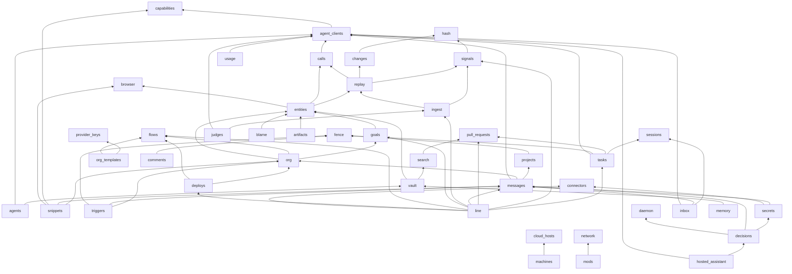

# Split `contracts` and the shared core into packages

Status: complete. The section "Progress" records the pull requests.

This document records the plan to move the former shared package into small domain packages. Paths under `shared/` in the original measurements refer to that former package.

## Summary

- The code in `shared` is in 8 folders: `contracts`, `entities`, `tasks`, `render`, `replay`, `search`, `changes` and `ratchet`. The plan calls these folders the core folders.
- **No module cycle crosses a folder.** A module cycle is a set of modules that import each other, directly or through other modules. Some folders import each other, but each of these folder cycles is made of one-way module chains. Thus, correct placement of each module removes all folder cycles.
- The plan divides only one module: the FNV hash functions in `inboxProjection` go to a new `@codecast/hash` package.
- Inside `contracts`, there are 5 module cycles. Each cycle has 2 or 3 modules. Each cycle moves as one unit.
- The `contracts` barrel is a large part of the work. A barrel is a module that only re-exports the names of other modules. A caller can then import names from many modules through one path. **1,113 files import `@codecast/shared/contracts`**, and 95 of the 105 modules that it re-exports have no other import path. Thus, each move also rewrites the barrel imports of the moved names.
- The target is 48 domain packages: 44 new packages, and 4 older packages (`mods`, `network`, `vault`, `agents`) that get more modules.
- The plan has 9 stages and 61 parts. Stage 1 prepares the code and has 3 parts. Stages 2 to 9 have 58 moves. Each move rewrites 150 importers or fewer.
- The `agentClients` module cycle has 211 importers. Thus, its move has two parts (refer to "Stage 3").

## Measured numbers

The numbers in this document (importer counts, file counts, line counts and barrel counts) come from one tree: commit `0a2b5eb53`, with the merges of PRs #46, #52 and #50 applied. These three PRs moved `docs`, `chat`, `agents`, `memory`, `vault`, `comments`, `blame` and `artifacts` into packages.

The numbers show the size of each move. They do not show the current state of `main`. After a module moves, the files that import it change, and some modules grow or become smaller.

## Progress

The table records how the extraction reached completion.

| Package or change                                                          | State          |
| -------------------------------------------------------------------------- | -------------- |
| Plan and measurement scripts                                               | Merged, PR #54 |
| Hash functions, test split, and root barrel removal                        | Merged, PR #55 |
| `pull-requests`, `convex-errors`, `keyboard`, `network`, `ratchet`, `ship` | Merged, PR #56 |
| `capabilities`, `policy`                                                   | Merged, PR #57 |
| `browser`, `pages`, `provider-keys`, `daemon`, `evals-api`                 | Merged, PR #58 |
| `cloud-hosts`, `flows`                                                     | Merged, PR #59 |
| `calls` (first part)                                                       | Merged, PR #60 |
| `render`, `triggers` (first part), `decisions` (first part)                | Merged, PR #61 |
| Root barrel documentation                                                  | Merged, PR #62 |
| `agent-clients` (first part), `changes`, `signals`                         | Merged, PR #63 |
| `sessions` (first part)                                                    | Merged, PR #64 |
| `fence`, `org` (first part)                                                | Merged, PR #74 |
| `machines`, `mods`, `search`, `sessions` (second part)                     | Merged, PR #75 |
| `org` (second part), `projects`, `deploys`                                 | Merged, PR #76 |
| `agent-clients` (second part)                                              | Merged, PR #77 |
| `agent-clients` (third part), `agents`, `hosted-assistant`, `usage`        | Merged, PR #78 |
| `replay`, `calls` (second part), `entities`, `ingest`                      | Merged, PR #79 |
| `connectors`, `goals`                                                      | Merged, PR #81 |
| `org` (third part), `org-templates`                                        | Merged, PR #82 |
| `messages`, `snippets`                                                     | Merged, PR #83 |
| `inbox`, `secrets`, `triggers` (second part), `decisions` (second part)    | Merged, PR #84 |
| `tasks`, `calls` (last part), `agent-clients` (last part)                  | Merged, PR #85 |
| `judges`, `vault`, `line` (first part)                                     | Merged, PR #86 |
| `line` (second part)                                                       | Merged, PR #87 |
| Contracts barrel and shared package removal                                | Merged, PR #88 |

## Scripts

The scripts and their input files are in `docs/architecture/contracts-split/`:

| File           | What it does                                                                                                                                                                                                                             |
| -------------- | ---------------------------------------------------------------------------------------------------------------------------------------------------------------------------------------------------------------------------------------- |
| `graph.ts`     | Parses each import specifier with the TypeScript parser: static imports, `export … from`, `import()`, `require`, `mock.module` and `import("…").T` type queries. It resolves `@codecast/shared/*` through the `exports` map of `shared`. |
| `analyze.ts`   | Makes the module graph, the module cycles, the fan-in of each module, and the module that defines each name in the barrel.                                                                                                               |
| `table.ts`     | Writes the table of modules.                                                                                                                                                                                                             |
| `check.ts`     | Makes the package graph from `assign.txt`, and finds the cycles in it.                                                                                                                                                                   |
| `plan.ts`      | Examines `stages.txt`. It makes sure that each dependency moves in an earlier stage or in the same part, and that no module is in two parts. It counts the importers of each part.                                                       |
| `assign.txt`   | The target package of each module.                                                                                                                                                                                                       |
| `stages.txt`   | One line for each part: the stage number, the part name, the package and the modules.                                                                                                                                                    |
| `reasons.json` | The reason for each package, as in the column "Why it is one thing" in section 2.                                                                                                                                                        |

To run the scripts again, go to that folder and run:

```bash
bun graph.ts <tree> edges.json && bun analyze.ts <tree> edges.json report.json && bun table.ts <tree> && bun check.ts && bun plan.ts
```

`<tree>` is the path of a checkout. The scripts write JSON files into the folder, and `.gitignore` excludes them. `bun check.ts assign.txt notests` does the cycle check without test edges. `plan.ts` writes `problems: 0` on its last line when the plan has no problems.

To get the measured numbers again, use a checkout of `a929b1c0a` (that is, `0a2b5eb53` with #46 and #52) and apply the four commits of #50: `ede387022`, `0a7e7c277`, `811887707` and `35be1a5c9`.

These commits cause conflicts in some `package.json` files, in `bun.lock`, in `apps/cli/src/daemonBuildId.ts` and in `apps/cli/src/repoMirror.ts`. In `repoMirror.ts`, keep the import from `@codecast/shared/contracts`. On that tree, the scripts give the counts in this document, with one difference: the third part of `org` has 102 importers, not 101. On a later tree, a module that moved has no importers in `shared`, so its counts are 0.

## 1. The graph

### 1.1 Size

| Folder      | Source modules                             | Test files | Notes                                                              |
| ----------- | ------------------------------------------ | ---------- | ------------------------------------------------------------------ |
| `contracts` | 246, plus `index.ts` and 3 fixture modules | 186        | 241 top-level modules and 5 under `evalsApi/`                      |
| `entities`  | 1 (`index.ts`, 1,646 lines)                | 4          |                                                                    |
| `tasks`     | 13                                         | 11         | `tasks/index.ts` is a barrel **and** has 418 lines of its own code |
| `render`    | 17, plus `css-tree.d.ts`                   | 9          |                                                                    |
| `replay`    | 11, plus `mobile.fixture.ts`               | 9          |                                                                    |
| `search`    | 4                                          | 3          |                                                                    |
| `changes`   | 11, plus 3 fixtures                        | 9          |                                                                    |
| `ratchet`   | 1                                          | 3          | Also has 2 baseline files                                          |

2,203 files outside `shared` import a module from `contracts`. 1,255 of these files use a subpath, 1,113 use the barrel, and 164 use the two.

### 1.2 Folder cycles and the edges that make them

An edge is one import from one module to another module. This table gives all the edges that cross folders, without test files.

| From                                                                         | To                                                                                                                     |
| ---------------------------------------------------------------------------- | ---------------------------------------------------------------------------------------------------------------------- |
| `contracts/linePriority`                                                     | `tasks/index` (the `TaskPriority` type, defined in `tasks/statuses`)                                                   |
| `contracts/superseded`                                                       | `tasks/statuses` (`isTerminalTaskStatus`)                                                                              |
| `contracts/initiative`                                                       | `entities/index` (`parseEntityUrl`), and `@codecast/chat/handles`                                                      |
| `contracts/orgProposalReply`                                                 | `entities/index` (`proposalChangeRefId`)                                                                               |
| `contracts/callRoomKeys`                                                     | `@codecast/chat/dm` and `@codecast/team/memberKind`. These are packages already, so they make no cycle.                |
| `entities/index`                                                             | `contracts/browserPaneOffer`, `callLinks`, `callRecordings`, `replayPlayer`, and `replay/events`                       |
| `tasks/index`                                                                | `contracts/agentClients` (`isHostedAgentType`)                                                                         |
| `tasks/foreignText`, `planForeignText`, `resume`                             | `contracts/fence`                                                                                                      |
| `tasks/graph`                                                                | `contracts/prRefs`                                                                                                     |
| `tasks/planState`                                                            | `contracts/workState`                                                                                                  |
| `render/changeCardHtml`                                                      | `contracts/changeCard` (the only render module that imports `contracts`)                                               |
| `search/sessionQuery`                                                        | `contracts/prRefs`                                                                                                     |
| `replay/{capture,dom,events,issues,list,mobile,moment,repro,rrweb,timeline}` | `contracts/replay`                                                                                                     |
| `replay/dom`                                                                 | `contracts/replayPlayer`                                                                                               |
| `replay/issues`                                                              | `contracts/signalFingerprint`                                                                                          |
| `replay/moment`, `replay/timeline`                                           | `changes/headline` (`clip`)                                                                                            |
| `changes/keys`                                                               | `contracts/inboxProjection` (`fnv1a32Update`, `FNV1A32_OFFSET`)                                                        |
| `contracts/signalFingerprint`                                                | `contracts/inboxProjection` (`fnv1a32`). This edge is inside `contracts`, but it sets the possible place of `signals`. |

These test edges cross folders:

| From                                           | To                                    | Note                             |
| ---------------------------------------------- | ------------------------------------- | -------------------------------- |
| `contracts/changeCard.test`                    | `render/changeCardHtml`               | It imports nothing from `tasks`. |
| `contracts/orgProposal.test`                   | `entities` (`parseProposalChangeRef`) |                                  |
| `entities/callMoments.test`                    | `contracts/callLinks`                 |                                  |
| `replay/{issues,list,moment,navs,replay}.test` | `contracts/replay`                    |                                  |
| `replay/mobile.test`                           | `contracts/replayPlayer`              |                                  |
| `tasks/{foreignText,planForeignText}.test`     | `contracts/fence`                     |                                  |

### 1.3 Module cycles

A strongly connected component (SCC) is a largest module cycle: no other module can join it and keep it a cycle. The graph without test files has 306 modules. **Each SCC is inside `contracts`.** No SCC crosses a folder.

| SCC | Members                                            | The imports that close the cycle                                                                                                             |
| --- | -------------------------------------------------- | -------------------------------------------------------------------------------------------------------------------------------------------- |
| 1   | `agentClients`, `antigravityClient`, `cloudAgents` | Type-only `AgentClientId` imports in one direction, and value imports (`ANTIGRAVITY_CLIENT`, `CLOUD_AGENT_PROVIDERS`) in the other direction |
| 2   | `callGuests`, `callRecordings`                     | `recordingKeptWords` in one direction, `isGuestIdentity` and `markedName` in the other direction                                             |
| 3   | `agentJudges`, `judges`                            |                                                                                                                                              |
| 4   | `envs`, `envCases`                                 |                                                                                                                                              |
| 5   | `flowMap`, `lineFunnel`, `lineVolume`              |                                                                                                                                              |

Each SCC moves as one unit in one part. The plan divides no SCC.

Test files add **package** cycles when their modules go to different packages. If a test imports a module in a higher package, the lower package then depends on the higher package. Stage 1 changes 7 test files to prevent these cycles. The plan also gives 10 more test files to a higher package than their names show. Section 3 lists the two groups.

### 1.4 Fan-in

The fan-in of a module is the number of files that import it. Each barrel import counts for the module that defines the imported name. Columns:

- **out**: importers outside `shared`.
- **in**: importers in the core folders, without tests.
- **tests**: test files in the core folders that import the module.

The 35 highest:

| Module                    | Lines | out | in  | tests | Where the outside importers are                                                                       |
| ------------------------- | ----- | --- | --- | ----- | ----------------------------------------------------------------------------------------------------- |
| contracts/agentClients    | 1631  | 157 | 11  | 4     | cli 50, mobile 5, server 38, web 63, packages/agents 1                                                |
| entities/index            | 1646  | 124 | 2   | 5     | cli 7, evals 1, mobile 25, server 8, web 79, packages/artifacts 2, packages/blame 1, packages/vault 1 |
| tasks/index               | 460   | 112 | 1   | 4     | cli 17, mobile 8, server 42, web 45                                                                   |
| contracts/machineMessages | 1163  | 94  | 9   | 13    | cli 22, evals 3, mobile 1, server 40, web 28                                                          |
| contracts/initiative      | 1409  | 84  | 5   | 4     | cli 7, mobile 2, server 14, web 61                                                                    |
| contracts/evalsApi        | 34    | 74  | 0   | 1     | cli 2, evals 31, web 41                                                                               |
| contracts/secrets         | 1252  | 69  | 2   | 3     | cli 22, mobile 5, server 11, web 31                                                                   |
| contracts/callRoomKeys    | 365   | 63  | 2   | 3     | cli 1, mobile 9, server 20, web 33                                                                    |
| contracts/changeCard      | 1308  | 61  | 2   | 2     | cli 5, mobile 1, server 14, web 41                                                                    |
| contracts/assistant       | 466   | 61  | 0   | 3     | mobile 4, server 17, web 40                                                                           |
| contracts/orgProposal     | 3709  | 60  | 2   | 6     | cli 7, evals 2, mobile 2, server 9, web 40                                                            |
| contracts/ingest          | 1084  | 60  | 0   | 5     | cli 6, server 28, web 26                                                                              |
| contracts/agentStatus     | 368   | 59  | 2   | 3     | cli 16, mobile 1, server 19, web 23                                                                   |
| contracts/inboxProjection | 1888  | 57  | 2   | 11    | cli 1, server 21, web 35                                                                              |
| contracts/cloudAgents     | 869   | 52  | 2   | 1     | cli 18, mobile 3, server 3, web 28                                                                    |
| contracts/apiErrorBanner  | 652   | 52  | 0   | 6     | cli 21, mobile 1, server 12, web 18                                                                   |
| tasks/statuses            | 268   | 51  | 5   | 1     | cli 4, mobile 1, server 24, web 22                                                                    |
| contracts/orgLead         | 279   | 49  | 3   | 2     | cli 4, evals 1, server 24, web 20                                                                     |
| contracts/snippets        | 2005  | 46  | 1   | 3     | cli 29, web 17                                                                                        |
| contracts/flowPool        | 458   | 44  | 5   | 1     | cli 13, mobile 3, server 7, web 21                                                                    |
| contracts/callGuests      | 543   | 44  | 1   | 1     | cli 1, mobile 3, server 11, web 29                                                                    |
| contracts/callRecordings  | 831   | 43  | 6   | 1     | cli 6, mobile 6, server 14, web 17                                                                    |
| replay/index              | 119   | 42  | 0   | 2     | cli 1, mobile 3, server 17, web 21                                                                    |
| contracts/teamFeatures    | 239   | 40  | 1   | 2     | cli 2, mobile 3, server 9, web 26                                                                     |
| contracts/replay          | 491   | 39  | 11  | 6     | cli 3, server 19, web 17                                                                              |
| contracts/usageLimits     | 818   | 38  | 0   | 1     | cli 7, mobile 2, server 10, web 19                                                                    |
| contracts/prRefs          | 204   | 36  | 3   | 1     | cli 4, mobile 1, server 20, web 11                                                                    |
| contracts/orgAvatars      | 63    | 35  | 3   | 4     | mobile 3, playground 6, server 6, web 20                                                              |
| contracts/decisionAnswers | 158   | 34  | 0   | 3     | server 11, web 20, mobile 3                                                                           |
| contracts/threadState     | 378   | 34  | 0   | 1     | cli 8, mobile 1, server 10, web 15                                                                    |
| search/index              | 40    | 34  | 0   | 1     | cli 1, mobile 4, server 12, web 17                                                                    |
| contracts/convexErrors    | 81    | 33  | 0   | 1     | cli 6, server 2, web 23, mobile 2                                                                     |
| tasks/graph               | 1260  | 32  | 5   | 1     | cli 8, mobile 3, server 9, web 12                                                                     |
| contracts/managedPolicy   | 558   | 32  | 1   | 1     | cli 6, mobile 2, server 6, web 18                                                                     |
| contracts/vaultProtocol   | 409   | 32  | 0   | 1     | packages/vault 2, cli 10, web 20                                                                      |

Nine modules have no importer outside `shared`: `lineRunEnd`, `antigravityClient`, `approvalAnswers`, `orgProposalReply`, and the 5 internal modules of `evalsApi/`. Appendix A gives the fan-in of each module, in groups by target package.

### 1.5 Barrel usage

A folder barrel is the `index.ts` of a folder that re-exports the modules of that folder, for example `tasks/index.ts`. A subpath export is an entry in the `exports` map of a `package.json`, for example `"./prRefs"`. It gives one module its own import path.

- **The root barrel of `@codecast/shared`** was the root `index.ts` of the package, with only `export * from "./contracts"`. **0 files imported it.** Only `package.json` dependency lines named it. Stage 1 deleted it.
- **`@codecast/shared/contracts`** (`contracts/index.ts`) has 98 `export *` lines, and named re-exports from `sessionSnooze` and `sessionAsk`. Through nested `export *` chains, these lines re-export 105 modules.
  - 95 of these 105 modules have **no subpath export** in `shared/package.json`. For these modules, the barrel is the only import path.
  - The other 10 modules have a subpath export and a barrel line: `modelOptions`, `cloudAgents`, `orgTemplateBind`, `castPlayer`, `managedPolicy`, `vendorCoverage`, `vaultProtocol`, `convexErrors`, `decisionAnswers`, `agentToolSetup`.
  - 145 modules of `contracts` have only a subpath export. Nine modules have no import path: `antigravityClient`, `approvalAnswers`, `lineRunEnd`, `orgProposalReply` and the 5 `evalsApi/*` modules.
  - **Importers:** 1,113 files. These are web 508, cli 289, server 269, mobile 43, evals 3, `packages/agents` 1, and shared 2 (`capabilityScopes.test` and `capabilitySlug.test`, which import `./index`). 949 of these files use only the barrel.
  - **Names:** 1,180 different names. 162 of the import declarations are type-only.
  - **Files for each module that defines barrel names**. These are the 25 highest: agentClients 156, machineMessages 94, callRoomKeys 63, agentStatus 59, inboxProjection 57, apiErrorBanner 51, cloudAgents 51, snippets 47, callGuests 44, callRecordings 43, teamFeatures 40, usageLimits 38, prRefs 36, threadState 34, decisionAnswers 32, vaultProtocol 30, closedSession 29, convexErrors 29, managedPolicy 28, capabilityScopes 27, deviceName 27, cloudHostReport 25, systemResources 24, cloudPlacement 23, agentToolSetup 22.
  - **Dynamic imports and type queries:** 32 sites in 17 files. They name these modules:

    | File                                       | Names                                                           | Defining modules                                                              |
    | ------------------------------------------ | --------------------------------------------------------------- | ----------------------------------------------------------------------------- |
    | `apps/cli/src/daemon.ts`                   | `HostReadiness`, `resolveAgentLaunch`, `REWIND_FILES_OPS`       | cloudHostReport, agentDefinitions, rewindFiles                                |
    | `apps/cli/src/index.ts`                    | `DEFAULT_CLAUDE_BACKEND`/`asClaudeBackend`, `explainAskFailure` | claudeBackend, sessionAsk                                                     |
    | `apps/cli/src/cloud/cli.ts`                | `wakePhaseLine`                                                 | cloudHostReport                                                               |
    | `apps/cli/src/remote/cli.ts`               | `checkoutInUseMessage`                                          | cloudWorkspace                                                                |
    | `apps/cli/src/syncService.ts`              | `MachineResourceSnapshot`                                       | systemResources                                                               |
    | `apps/web/lib/deviceRow.ts`                | 4 types                                                         | cloudHostReport, cloudAgents                                                  |
    | `apps/web/store/inboxStore.ts`             | 9 type queries                                                  | cloudHostReport, localMirror, triggerEvents                                   |
    | `apps/web/perf/harness.tsx`                |                                                                 | inboxFields, inboxProjection                                                  |
    | `apps/web/test-helpers/missingBackend.tsx` |                                                                 | teamFeatures                                                                  |
    | 8 test files                               |                                                                 | snippets, managedPolicy, callGuests, idleDigest, machineMessages, orgProposal |

    The `import()` calls in `apps/cli/src/daemon.ts` and `apps/cli/src/index.ts` load the **full** barrel when they run.

- **Other folder barrels** move with their package and become its root export:

  | Barrel          | Files that import it |
  | --------------- | -------------------- |
  | `tasks/index`   | 117                  |
  | `replay/index`  | 44                   |
  | `search/index`  | 35                   |
  | `render/index`  | 33                   |
  | `changes/index` | 20                   |

- No `mock.module` call names a module in `shared`.

## 2. Target packages

Each package depends only on other packages in this list, or on packages that existed before the plan (`@codecast/chat`, `@codecast/team`, `@platform/*`). **No package in the list depends on the former shared package.** At the measured commit, the apps and several workspace libraries still depended on it.

How to read the table:

- **Layer** is the length of the longest dependency path from the package to a package with no dependencies. Test edges count.
- **Importers** is the number of different files outside the package that import one of its modules after the move. Each barrel import counts for the module that defines the name.
- Module names do not show the `contracts/` prefix.
- A dependency after `tests:` comes only from a test file or a fixture that moves with the package.
- The importer count is for the full package. Section 3 gives the count for each part of a package that moves in more than one part.

| Layer | Package                        | Members                                                                                                                                                                                                                                                                                                                                                            | Depends on                                                                                                         | Importers | Why it is one thing                                                                                                                            |
| ----- | ------------------------------ | ------------------------------------------------------------------------------------------------------------------------------------------------------------------------------------------------------------------------------------------------------------------------------------------------------------------------------------------------------------------ | ------------------------------------------------------------------------------------------------------------------ | --------- | ---------------------------------------------------------------------------------------------------------------------------------------------- |
| 0     | `@codecast/browser`            | browserExtension, browserPaneOffer, browserStream                                                                                                                                                                                                                                                                                                                  | —                                                                                                                  | 17        | Browser pane offers, remote browser watching, and the extension store link.                                                                    |
| 0     | `@codecast/capabilities`       | capabilities, capabilityScopes, fleetDiff, agentToolSetup, mcpRegistry, agentAccess                                                                                                                                                                                                                                                                                | —                                                                                                                  | 85        | The capability library: kinds, scopes, per-machine diff, setup cards, the MCP registry and the outside-agent catalog.                          |
| 0     | `@codecast/cloud-hosts`        | cloudHostReport, cloudPlacement, cloudPlacementProgress, cloudWorkspace, localMirror                                                                                                                                                                                                                                                                               | —                                                                                                                  | 58        | The cloud host: its report, placement, progress, workspace mode and local mirror.                                                              |
| 0     | `@codecast/convex-errors`      | convexErrors                                                                                                                                                                                                                                                                                                                                                       | —                                                                                                                  | 33        | Reading Convex validator errors into plain words.                                                                                              |
| 0     | `@codecast/daemon`             | daemonCommands, rewindFiles, sshAttach, terminalStream, fileAttachment, shellWords                                                                                                                                                                                                                                                                                 | —                                                                                                                  | 36        | Commands the daemon runs and the terminal/ssh contracts around them.                                                                           |
| 0     | `@codecast/evals-api`          | evalsApi, evalsApi/bisect, evalsApi/core, evalsApi/endpoints, evalsApi/routes, evalsApi/sim                                                                                                                                                                                                                                                                        | —                                                                                                                  | 74        | The evals UI wire contract. The name avoids a clash with the existing `@codecast/evals` app.                                                   |
| 0     | `@codecast/fence`              | fence                                                                                                                                                                                                                                                                                                                                                              | —                                                                                                                  | 26        | Fencing foreign text before an agent reads it: the codecast wrapper over `@platform/fence`.                                                    |
| 0     | `@codecast/flows`              | flowPool, flowEdit, repoFlows, runStart, lineSlug, linePhases                                                                                                                                                                                                                                                                                                      | —                                                                                                                  | 73        | A flow as stations: pool, edits, repo flows, run start, line slug, phases.                                                                     |
| 0     | `@codecast/hash`               | fnv1a32 (new module, stage 1)                                                                                                                                                                                                                                                                                                                                      | —                                                                                                                  | 12        | Stable non-crypto hashes (FNV-1a 32) that the inbox digest, change keys and signal fingerprints share. This is the only module division.       |
| 0     | `@codecast/keyboard`           | shortcutCatalog, keyBindings                                                                                                                                                                                                                                                                                                                                       | —                                                                                                                  | 9         | The keyboard shortcut catalog and personal bindings.                                                                                           |
| 0     | `@codecast/network` (existing) | internalHost                                                                                                                                                                                                                                                                                                                                                       | —                                                                                                                  | 2         | Existing package (WebSocket recovery). `internalHost` is the private-address rule, which belongs to the same network domain.                   |
| 0     | `@codecast/pages`              | castPlayer, castMotion, pageAgent, pageAnchor, pageData, pageEdge                                                                                                                                                                                                                                                                                                  | —                                                                                                                  | 26        | Published pages: the player, motion pages, page agent, anchors, live data, the edge.                                                           |
| 0     | `@codecast/policy`             | managedPolicy, vendorCoverage, teamFeatures, permissionRules                                                                                                                                                                                                                                                                                                       | —                                                                                                                  | 88        | What a team or IT admin switches on or locks: feature flags, managed policy, vendor coverage, permission rules.                                |
| 0     | `@codecast/provider-keys`      | providerKeys, providerKeyCrypto, oauthCodePaste                                                                                                                                                                                                                                                                                                                    | —                                                                                                                  | 21        | Provider API keys and the sign-ins that produce them.                                                                                          |
| 0     | `@codecast/pull-requests`      | prRefs, commitDiffs                                                                                                                                                                                                                                                                                                                                                | —                                                                                                                  | 41        | How a pull request and its commits are named.                                                                                                  |
| 0     | `@codecast/ratchet`            | ratchet/index                                                                                                                                                                                                                                                                                                                                                      | —                                                                                                                  | 6         | The existing `ratchet` folder: the max-lines and doc-refs ratchets, with their baselines.                                                      |
| 0     | `@codecast/render`             | render/canvasCss, render/codeRuns, render/codecastMark, render/format, render/index, render/mobileSessionStyle, render/mobileTabsStyle, render/pageTheme, render/permissionCardStyle, render/structuredMessage, render/structuredResult, render/toolCall, render/toolKinds, render/toolNames, render/toolVisual, render/typeScale                                  | —                                                                                                                  | 53        | The existing `render` folder minus `changeCardHtml`: tool-call, structured-message and theme rendering.                                        |
| 0     | `@codecast/sessions`           | agentStatus, liveness, hibernation, workState, loopState, openTasks, pendingStatus, sessionRead, sessionSnooze, sessionProject, newSessionDefaults, taskStats, conversationFields, liveActivity, threadState, unattended, forkSeed, sessionAsk, deliveryFailed, deliveryHold, follow                                                                               | —                                                                                                                  | 185       | The vocabulary of one session's lifecycle and state: status, liveness, work state, loops, snooze, thread state, delivery holds.                |
| 0     | `@codecast/ship`               | shipPlan, changeGuide                                                                                                                                                                                                                                                                                                                                              | —                                                                                                                  | 19        | The Ship control and the change guide.                                                                                                         |
| 1     | `@codecast/agent-clients`      | agentClients, antigravityClient, cloudAgents, cloudSessionSync, modelOptions, agentPins, agentSwitch, claudeBackend, capabilityResolver, fixture:capabilityResolverGolden, executionBinding, apiErrorBanner, harnessHooks, slashCommand, subagentFleet, testArtifacts                                                                                              | `capabilities`                                                                                                     | 279       | The registry of supported agent CLIs and models, and the per-client behaviour around them (backends, hooks, banners, the capability resolver). |
| 1     | `@codecast/changes`            | changes/classify, changes/cluster, changes/dedupe, changes/headline, changes/index, changes/keys, changes/people, changes/risks, changes/surfaces, changes/types, changes/week, changes/fixture:commit, changes/fixture:(third fixture)                                                                                                                            | `hash`                                                                                                             | 22        | The existing `changes` folder: classifying and clustering commits into a week of changes.                                                      |
| 1     | `@codecast/machines`           | deviceName, systemResources, resourceOffloadIntent, resourceOffloadPolicy, moveRehearsal, machineSwitch, peerTransport, teamHosts, dataSync, checkouts, worktrees                                                                                                                                                                                                  | `cloud-hosts`                                                                                                      | 106       | Devices a person runs sessions on: names, resources, moves, peers, team hosts, checkouts, worktrees.                                           |
| 1     | `@codecast/mods` (existing)    | mods, theme                                                                                                                                                                                                                                                                                                                                                        | `network`                                                                                                          | 40        | Existing package. The mod contract and the themes a mod declares. Nothing in shared imports either module.                                     |
| 1     | `@codecast/projects`           | projectContext, projectOutputs, projectRef                                                                                                                                                                                                                                                                                                                         | `fence`                                                                                                            | 10        | The project a session works in: its context, outputs and references.                                                                           |
| 1     | `@codecast/search`             | search/index, search/sessionQuery, search/terms, search/tokenize, levenshtein                                                                                                                                                                                                                                                                                      | `pull-requests`                                                                                                    | 39        | The existing `search` folder, plus edit distance for typo recovery.                                                                            |
| 1     | `@codecast/signals`            | signalFingerprint, problemReach                                                                                                                                                                                                                                                                                                                                    | `hash`                                                                                                             | 25        | Signal fingerprints (the dedupe key) and the people a problem reached.                                                                         |
| 2     | `@codecast/calls`              | callRoomKeys, callGuests, callRecordings, callLinks, callPush, huddleDigest, screenRecording, recordingAudio, transcribeLanguage, transcriptChunk, stagePins                                                                                                                                                                                                       | `@codecast/chat`, `@codecast/team`, `agent-clients`                                                                | 160       | Huddles: room keys, guests, recordings, call links, push, digests, transcripts, stage pins.                                                    |
| 2     | `@codecast/tasks`              | tasks/foreignText, tasks/frontier, tasks/graph, tasks/graphHistory, tasks/index, tasks/planForeignText, tasks/planState, tasks/planSteps, tasks/planVerdicts, tasks/relatedDocs, tasks/resume, tasks/resumeSources, tasks/statuses                                                                                                                                 | `agent-clients`, `fence`, `pull-requests`, `sessions`                                                              | 115       | The existing `tasks` folder: task statuses, graph, plans and resume.                                                                           |
| 2     | `@codecast/usage`              | usageLimits, weeklyCard                                                                                                                                                                                                                                                                                                                                            | `agent-clients`                                                                                                    | 52        | Usage-limit windows per account, and the weekly usage card.                                                                                    |
| 3     | `@codecast/replay`             | replay, replayPlayer, replay/capture, replay/dom, replay/events, replay/index, replay/issues, replay/list, replay/mobile, replay/mobile.fixture, replay/moment, replay/repro, replay/rrweb, replay/timeline                                                                                                                                                        | `calls`, `changes`, `signals`                                                                                      | 70        | The replay stream, its player, and the replay folder's capture and analysis.                                                                   |
| 4     | `@codecast/entities`           | entities/index, appSurfaces                                                                                                                                                                                                                                                                                                                                        | `browser`, `calls`, `replay`                                                                                       | 129       | How every codecast object is named and addressed (ids, routes, URLs), plus the app's addressable surfaces.                                     |
| 5     | `@codecast/goals`              | initiative, metricStanding, goalsBrief, predictedEffect, envs, envCases, climb, openPlans                                                                                                                                                                                                                                                                          | `@codecast/chat`, `entities`                                                                                       | 124       | Initiatives and their metrics, environments, climbs and predicted effects.                                                                     |
| 5     | `@codecast/vault` (existing)   | vaultProtocol, vaultMirror                                                                                                                                                                                                                                                                                                                                         | `entities`, `search`                                                                                               | 34        | Existing notes-vault package. Its loopback and mirror protocols are already imported by `packages/vault`.                                      |
| 6     | `@codecast/agents` (existing)  | agentDefinitions                                                                                                                                                                                                                                                                                                                                                   | `agent-clients`, `vault`                                                                                           | 17        | Existing package that holds the file form of agent definitions. `agentDefinitions` is the contract it parses.                                  |
| 6     | `@codecast/org`                | orgAreas, orgAssignee, orgAvatars, orgCapacity, orgChange, orgChangeWords, orgIdentity, orgLead, orgLog, orgProposal, orgProposalReply, orgReview, orgRoute, orgSessionFiling, roleAutonomy, roleCard, roleFailover, roleGoals, roleIcon, roleIconExamples, roleLevel, rolePlaybook, briefStanding, headOfPeoplePrompt, executiveAssistantPrompt, sessionCharacter | `entities`, `flows`, `goals`                                                                                       | 248       | The organization: roles, leads, areas, avatars and icons, proposals, the org log, capacity, playbooks.                                         |
| 7     | `@codecast/deploys`            | deployTargets, lineDeploy, deployReach, deployAuthority, pipeline                                                                                                                                                                                                                                                                                                  | `flows`, `org`                                                                                                     | 48        | Deploy targets, line deploy triggers, reach, authority, pipeline.                                                                              |
| 7     | `@codecast/messages`           | machineMessages, messagingPolicy, handoffPrompt, sendArrival, jointMessage, sessionGoal, sessionEscalation, orgWhere, plainText, redirectWords                                                                                                                                                                                                                     | `agent-clients`, `org`, `projects`                                                                                 | 139       | The text formats codecast writes into a transcript for agents to read: machine messages, joint turns, goals, escalations, handoffs, org-where. |
| 7     | `@codecast/org-templates`      | orgTemplateBind, orgTemplateLearning, orgTemplateLearningOptIn, orgTemplateManifest, orgTemplateReadiness, orgTemplateRelease, orgTemplateState                                                                                                                                                                                                                    | `flows`, `provider-keys`; tests: `org`                                                                             | 22        | Hiring roles from a template: manifest, readiness, release, state, learning loop.                                                              |
| 8     | `@codecast/snippets`           | snippets, featureExplainers, snippetsWorkflow, stableContext                                                                                                                                                                                                                                                                                                       | `browser`, `capabilities`, `messages`, `org`                                                                       | 51        | The installable agent-feature snippets, their explainers and the stable-context block.                                                         |
| 8     | `@codecast/triggers`           | triggerEvents, triggerLifecycle, triggerPrecheck                                                                                                                                                                                                                                                                                                                   | `fence`, `messages`, `org`                                                                                         | 30        | Trigger events, prechecks, and the lifecycle frame of a trigger run.                                                                           |
| 9     | `@codecast/ingest`             | ingest, moments, volumeWatch, metricMonitor, sanitizeText                                                                                                                                                                                                                                                                                                          | `replay`, `signals`; tests: `triggers`                                                                             | 95        | What a running product sends: ingest batches, moments, volume and metric watches, publisher-text sanitizing.                                   |
| 10    | `@codecast/connectors`         | appConnector, productView, connectorReasons, codecastConfig, codecastSignature, githubAppInstallState, appDescriptors                                                                                                                                                                                                                                              | —; tests: `ingest`                                                                                                 | 56        | Connecting an app: connector manifest, product views, signed requests, config, the app library, GitHub app install state.                      |
| 10    | `@codecast/judges`             | judges, agentJudges, judgeReview, judgeFix, modelCall                                                                                                                                                                                                                                                                                                              | `agent-clients`, `ingest`                                                                                          | 56        | Judges and model calls in the learning loop.                                                                                                   |
| 11    | `@codecast/line`               | causeHistory, deploys, changeCard, render/changeCardHtml, lineRunEnd, evalResult, proposalCard, flowMap, lineFunnel, lineVolume, linePriority, lineProfile, lineTimeline, lineWords, lineChat, superseded, regretRates, problemScore, expectations, mainRed, ciFailures                                                                                            | `connectors`, `deploys`, `flows`, `goals`, `ingest`, `messages`, `pull-requests`, `signals`, `tasks`; tests: `org` | 180       | The line: causes, deploys as objects, the change card (and its HTML renderer), run ends, funnels and volume, priority, profile, timeline, CI.  |
| 11    | `@codecast/secrets`            | secrets, secretRules, secretShapes, vaultMessages                                                                                                                                                                                                                                                                                                                  | `connectors`, `messages`                                                                                           | 88        | The secret vault: secrets, rules, credential shapes, and the vault-filled message.                                                             |
| 12    | `@codecast/decisions`          | decisionAnswers, decisionAreas, decisionCategory, decisionEscalation, decisionImpact, approvalAnswers, commandRun, personAsk                                                                                                                                                                                                                                       | `daemon`, `messages`, `secrets`                                                                                    | 66        | Decisions and approvals: answers, areas, categories, escalation, impact, run-as-permission.                                                    |
| 13    | `@codecast/hosted-assistant`   | assistant                                                                                                                                                                                                                                                                                                                                                          | `agent-clients`, `decisions`                                                                                       | 62        | The hosted assistant's shared vocabulary. The name avoids a clash with `@platform/assistant`.                                                  |
| 14    | `@codecast/inbox`              | inboxProjection, fixture:teamWorldGen, inboxFields, inboxMembership, inboxSplit, closedSession, idleDigest, fixture:inboxProjectionGen                                                                                                                                                                                                                             | `agent-clients`, `messages`, `sessions`; tests: `policy`, `hosted-assistant`                                       | 106       | The inbox projection, its fields, membership, split wire form, closed sessions and the idle digest.                                            |

These packages existed before the plan and get modules:

- `@codecast/mods` gets `mods` and `theme`, and then does not depend on `@codecast/shared`.
- `@codecast/network` gets `internalHost`. This move is complete.
- `@codecast/vault` gets `vaultProtocol` and `vaultMirror`. It stops its dependency on `@codecast/shared` after `entities` and `search` move.
- `@codecast/agents` gets `agentDefinitions`. `packages/agents/src/index.ts` imports `AgentClientId`, `parseExecutionAgentClientId` and 4 more types from the `contracts` barrel. After the moves of `agent-clients` and `agentDefinitions` rewrite this import, `agents` does not depend on `@codecast/shared`.

`packages/comments`, `blame` and `artifacts` keep their dependency on `@codecast/shared` until `fence` (stage 2) and `entities` (stage 4) move. Then they use `@codecast/fence` and `@codecast/entities`.

### 2.1 Package dependency graph

Each arrow goes from a package to a package that it imports. These are the edges without test files.



These edges come only from tests and fixtures. Each cycle check includes them.

- `org-templates` → `org` (`contracts/orgTemplateLearning.test` → `contracts/rolePlaybook`)
- `ingest` → `triggers` (`contracts/ingest.test` → `contracts/triggerEvents`)
- `connectors` → `ingest` (`contracts/appConnector.test` → `contracts/ingest`)
- `line` → `org` (`contracts/metricSeries.test` → `contracts/rolePlaybook`)
- `inbox` → `policy` (`contracts/__fixtures__/teamWorldGen` → `contracts/teamFeatures`)
- `inbox` → `hosted-assistant` (`contracts/inboxProjection.test` → `contracts/assistant`)

### 2.2 Proof that the package graph has no cycle

Three independent checks:

1. **Tarjan SCC.** `check.ts` uses the Tarjan SCC algorithm on the 48 packages, and on `comments`, `blame`, `artifacts` and `memory` as dependents. It finds **no SCC with more than one package**, with test edges and without them. This result needs the test changes of stage 1, and the test owners in `TEST_OWNER` in `plan.ts`.
2. **Layers.** Each package in this table has a finite layer: 1 more than the highest layer of its dependencies. Such a layer function exists only on a graph with no cycle. Thus, the table is a topological order: each package comes after all of its dependencies.

   | Layer | Packages                                                                                                                                                                                                                        |
   | ----- | ------------------------------------------------------------------------------------------------------------------------------------------------------------------------------------------------------------------------------- |
   | 0     | `browser`, `capabilities`, `cloud-hosts`, `convex-errors`, `daemon`, `evals-api`, `fence`, `flows`, `hash`, `keyboard`, `network`, `pages`, `policy`, `provider-keys`, `pull-requests`, `ratchet`, `render`, `sessions`, `ship` |
   | 1     | `agent-clients`, `changes`, `machines`, `mods`, `projects`, `search`, `signals`                                                                                                                                                 |
   | 2     | `calls`, `tasks`, `usage`                                                                                                                                                                                                       |
   | 3     | `replay`                                                                                                                                                                                                                        |
   | 4     | `entities`                                                                                                                                                                                                                      |
   | 5     | `goals`, `vault`                                                                                                                                                                                                                |
   | 6     | `agents`, `org`                                                                                                                                                                                                                 |
   | 7     | `deploys`, `messages`, `org-templates`                                                                                                                                                                                          |
   | 8     | `snippets`, `triggers`                                                                                                                                                                                                          |
   | 9     | `ingest`                                                                                                                                                                                                                        |
   | 10    | `connectors`, `judges`                                                                                                                                                                                                          |
   | 11    | `line`, `secrets`                                                                                                                                                                                                               |
   | 12    | `decisions`                                                                                                                                                                                                                     |
   | 13    | `hosted-assistant`                                                                                                                                                                                                              |
   | 14    | `inbox`                                                                                                                                                                                                                         |

3. **Stage order.** `plan.ts` compares each module edge, test edges included, with `stages.txt`. Each dependency of a module must move in an earlier stage or in the same part. **The result is 0 problems.** Thus, each part keeps the graph free of cycles. When a module moves, its dependencies moved before it, so the new package never imports `@codecast/shared`. The modules that stay in `shared` import the new package, and that direction is permitted.

Two placements keep the package graph free of cycles. Neither placement divides a file:

- `render/changeCardHtml` goes into `line`, with `changeCard`. If it moves with `render`, then `render` depends on `line`, and `changeCard.test` imports `render`.
- `messages` is above `org`. The only edges from `messages` to `org` are `machineMessages` → `orgAreas` (the type-only `AreaChange`) and `roleCard`. `org` never imports `messages`. Thus, `orgWhere` goes to `messages` and `triggerLifecycle` goes to `triggers`, because each of these modules imports from the two packages.

## 3. Stages

Rules for the stages:

- The parts of one stage can merge in any sequence.
- Each module in a part depends only on modules from earlier stages, or on modules in the same part. Tests count.
- Two parts of one stage do not move modules into the same package.

The parts of one stage move different modules. But they change some of the same importer files. Thus, expect text conflicts in import blocks and in the baseline files (refer to section 5).

### The steps of each move

Do these steps for each part that moves modules:

1. Make `packages/<name>/`, or add to it if it exists.
   - `package.json`: the name `@codecast/<name>`, `"type": "module"`, and one `exports` entry **for each module** (`"./agentClients": "./src/agentClients.ts"`). Add a `"."` entry only when the package replaces a folder barrel: `tasks`, `render`, `replay`, `search`, `changes` and `ratchet`.
   - `tsconfig.json`: the same as `packages/time/tsconfig.json`.
   - `src/` and `test/`. `cast check packages` examines only the `src/` and `test/` folders of each package.
2. Use `git mv` to move the modules into `src/` and their tests into `test/`. Put the fixtures that apps import (`inboxProjectionGen`, `teamWorldGen`, `codecastSignature.vectors.json`) in `src/__fixtures__/`, each with an `exports` entry.
3. Rewrite each importer to `@codecast/<name>/<module>`:
   - relative imports inside `shared`
   - `@codecast/shared/contracts/<module>` subpaths
   - **barrel imports**: divide the import declaration. The moved names come from their module subpath, and the other names stay.
   - dynamic `import()` calls and `import("…").T` type queries.
4. Delete the lines of the moved modules from `contracts/index.ts`, and their entries from the `exports` map of `shared/package.json`.
5. Add `"@codecast/<name>": "workspace:*"` to each workspace that imports the package. This includes `shared` while a module there imports it, `apps/cli`, `web`, `server`, `mobile`, `evals`, `playground`, and the `packages/*` that import it. Then run `bun install`.
6. Move the baseline entries of the moved files: the ratchet baselines in `packages/ratchet/` and `lint-baseline.json`. Run `RATCHET_WRITE=prune bun test` in `packages/ratchet`, and `bun run lint:prune`.
7. Do these checks: `cast check`, `bun test` in the package, the moved tests, and `apps/cli/src/bench/bootGraph.guard.test.ts`. If mobile imports the package, also do `apps/mobile/lib/bundleGraph.guard.test.ts` and `apps/mobile/metro.config.test.cjs`.

### Stage 1: preparation

This stage moves no package, except the new `hash` package.

| Part                            | What it does                                                                                                                                                                                                                                                         | Importers                                                                                                                                                                                                                                                                                                                              | Cycles that it removes                                                                                                                                                                                                                           |
| ------------------------------- | -------------------------------------------------------------------------------------------------------------------------------------------------------------------------------------------------------------------------------------------------------------------- | -------------------------------------------------------------------------------------------------------------------------------------------------------------------------------------------------------------------------------------------------------------------------------------------------------------------------------------- | ------------------------------------------------------------------------------------------------------------------------------------------------------------------------------------------------------------------------------------------------ |
| `hash`                          | **The only module division.** Move `FNV1A32_OFFSET`, `fnv1a32Update` and `fnv1a32` out of `contracts/inboxProjection.ts`, with no change, into a new module `fnv1a32.ts` in `@codecast/hash`. `inboxProjection` imports them for its own use and stops their export. | 12 files: `changes/keys`, `contracts/signalFingerprint`, `contracts/inboxProjection` and 3 of its tests (`.test`, `.golden.test`, `.rows.test`), `apps/server/convex/lib/r2.ts`, `apps/server/convex/lineLearn.ts`, `apps/web/hooks/useTemplateHire.ts`, `apps/web/store/inboxStore.ts`, `apps/web/store/__tests__/sim/{dsl,realm}.ts` | `changes` → `contracts` (the last edge from `changes` into `contracts`). It also removes the edge `signals` → `inbox`. Without this, `entities` → `replay` → `signals` → `inbox` → `messages` → `org` → `goals` → `entities` is a package cycle. |
| The test split                  | Changes only test files in `shared`. No product code changes. Refer to the list below.                                                                                                                                                                               | 7 test files changed, 5 test files added                                                                                                                                                                                                                                                                                               | The test-only package cycles `sessions` ↔ `inbox` and `goals` ↔ `messages`. It also removes the barrel from two tests, and lets `apiErrorBanner` stay out of the second part of `agent-clients`.                                                 |
| The deletion of the root barrel | Delete the root `index.ts` of `shared`, and the `"."`, `main` and `types` entries in its `package.json`.                                                                                                                                                             | 0                                                                                                                                                                                                                                                                                                                                      | Prevents new imports of the root barrel                                                                                                                                                                                                          |

The changes of the test split:

- `contracts/capabilityScopes.test.ts`: change `from "./index"` to `./capabilityScopes` and `./capabilities`. `SCOPE_KINDS` and `compareScopeNarrowness` are in `capabilities`.
- `contracts/capabilitySlug.test.ts`: change `from "./index"` to `./capabilities` and `./snippets`. This test then moves with `snippets`, because it uses `SNIPPET_CATALOG`.
- `contracts/cloudAgents.test.ts`: move the `apiErrorBanner` cases into a new file, `contracts/apiErrorBanner.cloudAgents.test.ts`.
- `contracts/agentStatus.test.ts`: move the `describe("heartbeat liveness window")` block, which calls `deriveLiveAt`, into a new file, `contracts/inboxProjection.liveness.test.ts`.
- `contracts/hibernation.test.ts` and `contracts/sessionSnooze.test.ts`: move the cases that import `inboxProjection` into `contracts/inboxProjection.hibernation.test.ts` and `contracts/inboxProjection.snooze.test.ts`.
- `contracts/initiative.test.ts`: move the cases that use `formatScheduledTask`, `parseScheduledTask` and `roleCardInitiativeLine` into a new file, `contracts/machineMessages.initiative.test.ts`.

Some tests go with the package that is above all the modules that they import:

| Test                                  | Package     |
| ------------------------------------- | ----------- |
| `machineMessages.decisionAnswer.test` | `decisions` |
| `machineMessages.vaultReady.test`     | `secrets`   |
| `metricSeries.test`                   | `line`      |
| `channelHuddle.test`                  | `calls`     |
| `commandsSession.test`                | `inbox`     |
| `decisionAnswerLabel.test`            | `decisions` |
| `initiativeRecord.test`               | `goals`     |
| `replayImport.test`                   | `replay`    |
| `runEnd.test`                         | `line`      |
| `momentWho.test`                      | `ingest`    |

### Stages 2 to 9

| Stage | Name                                                        |
| ----- | ----------------------------------------------------------- |
| 2     | Packages that depend only on existing packages              |
| 3     | Agent clients, session state, replay and search             |
| 4     | Entities, tasks, ingest and the web side of agent clients   |
| 5     | Goals, connectors, judges, vault and the first part of line |
| 6     | Org proposals and the org log                               |
| 7     | Messages and org templates                                  |
| 8     | Inbox, secrets, snippets and the rest of line and triggers  |
| 9     | The last decision modules and the end of the barrel         |

The table gives each move. "Part" shows the part of a package that moves in more than one part. "Count" is the number of modules that move. "Importers" is the number of files that the move rewrites. Module names do not show the `contracts/` prefix.

| Stage | Package            | Part   | Modules                                                                                                                                                                                                                                                                                                                           | Count | Importers |
| ----- | ------------------ | ------ | --------------------------------------------------------------------------------------------------------------------------------------------------------------------------------------------------------------------------------------------------------------------------------------------------------------------------------- | ----- | --------- |
| 2     | `agent-clients`    | 1 of 4 | cloudSessionSync, claudeBackend, harnessHooks, slashCommand, subagentFleet, testArtifacts                                                                                                                                                                                                                                         | 6     | 39        |
| 2     | `browser`          | —      | browserExtension, browserPaneOffer, browserStream                                                                                                                                                                                                                                                                                 | 3     | 17        |
| 2     | `calls`            | 1 of 3 | callRoomKeys, callGuests, callRecordings, callPush, recordingAudio, transcribeLanguage, stagePins                                                                                                                                                                                                                                 | 7     | 134       |
| 2     | `capabilities`     | —      | capabilities, capabilityScopes, fleetDiff, agentToolSetup, mcpRegistry, agentAccess                                                                                                                                                                                                                                               | 6     | 85        |
| 2     | `changes`          | —      | changes/classify, changes/cluster, changes/dedupe, changes/headline, changes/index, changes/keys, changes/people, changes/risks, changes/surfaces, changes/types, changes/week, changes/**fixtures**/codecastDays.json, changes/**fixtures**/commit, changes/**fixtures**/(third fixture)                                         | 14    | 22        |
| 2     | `cloud-hosts`      | —      | cloudHostReport, cloudPlacement, cloudPlacementProgress, cloudWorkspace, localMirror                                                                                                                                                                                                                                              | 5     | 58        |
| 2     | `convex-errors`    | —      | convexErrors                                                                                                                                                                                                                                                                                                                      | 1     | 33        |
| 2     | `daemon`           | —      | daemonCommands, rewindFiles, sshAttach, terminalStream, fileAttachment, shellWords                                                                                                                                                                                                                                                | 6     | 36        |
| 2     | `decisions`        | 1 of 2 | decisionAreas, decisionCategory, decisionEscalation, decisionImpact, approvalAnswers, personAsk                                                                                                                                                                                                                                   | 6     | 19        |
| 2     | `evals-api`        | —      | evalsApi, evalsApi/bisect, evalsApi/core, evalsApi/endpoints, evalsApi/routes, evalsApi/sim                                                                                                                                                                                                                                       | 6     | 74        |
| 2     | `fence`            | —      | fence                                                                                                                                                                                                                                                                                                                             | 1     | 26        |
| 2     | `flows`            | —      | flowPool, flowEdit, repoFlows, runStart, lineSlug, linePhases                                                                                                                                                                                                                                                                     | 6     | 73        |
| 2     | `keyboard`         | —      | shortcutCatalog, keyBindings                                                                                                                                                                                                                                                                                                      | 2     | 9         |
| 2     | `network`          | —      | internalHost                                                                                                                                                                                                                                                                                                                      | 1     | 2         |
| 2     | `org`              | 1 of 3 | orgAvatars, roleIcon, roleIconExamples, sessionCharacter, orgAssignee, orgLead, orgIdentity, orgRoute, executiveAssistantPrompt                                                                                                                                                                                                   | 9     | 128       |
| 2     | `pages`            | —      | castPlayer, castMotion, pageAgent, pageAnchor, pageData, pageEdge                                                                                                                                                                                                                                                                 | 6     | 26        |
| 2     | `policy`           | —      | managedPolicy, vendorCoverage, teamFeatures, permissionRules                                                                                                                                                                                                                                                                      | 4     | 88        |
| 2     | `provider-keys`    | —      | providerKeys, providerKeyCrypto, oauthCodePaste                                                                                                                                                                                                                                                                                   | 3     | 21        |
| 2     | `pull-requests`    | —      | prRefs, commitDiffs                                                                                                                                                                                                                                                                                                               | 2     | 41        |
| 2     | `ratchet`          | —      | ratchet/index                                                                                                                                                                                                                                                                                                                     | 1     | 6         |
| 2     | `render`           | —      | render/canvasCss, render/codeRuns, render/codecastMark, render/format, render/index, render/mobileSessionStyle, render/mobileTabsStyle, render/pageTheme, render/permissionCardStyle, render/structuredMessage, render/structuredResult, render/toolCall, render/toolKinds, render/toolNames, render/toolVisual, render/typeScale | 16    | 53        |
| 2     | `sessions`         | 1 of 2 | agentStatus, liveness, hibernation, workState, loopState, openTasks, pendingStatus, liveActivity, sessionRead, sessionSnooze                                                                                                                                                                                                      | 10    | 122       |
| 2     | `ship`             | —      | shipPlan, changeGuide                                                                                                                                                                                                                                                                                                             | 2     | 19        |
| 2     | `signals`          | —      | signalFingerprint, problemReach                                                                                                                                                                                                                                                                                                   | 2     | 25        |
| 2     | `triggers`         | 1 of 2 | triggerEvents, triggerPrecheck                                                                                                                                                                                                                                                                                                    | 2     | 17        |
| 3     | `agent-clients`    | 2 of 4 | agentClients, antigravityClient, cloudAgents, modelOptions, agentPins. Rewrites every importer except the ones in `apps/web`. Leaves 5 one-line shims at the old paths for web.                                                                                                                                                   | 5     | 125       |
| 3     | `calls`            | 2 of 3 | callLinks, huddleDigest, screenRecording                                                                                                                                                                                                                                                                                          | 3     | 38        |
| 3     | `machines`         | —      | deviceName, systemResources, resourceOffloadIntent, resourceOffloadPolicy, moveRehearsal, machineSwitch, peerTransport, teamHosts, dataSync, checkouts, worktrees                                                                                                                                                                 | 11    | 106       |
| 3     | `mods`             | —      | mods, theme                                                                                                                                                                                                                                                                                                                       | 2     | 40        |
| 3     | `org`              | 2 of 3 | orgCapacity, orgReview, roleAutonomy, roleCard, roleFailover, roleGoals, roleLevel, briefStanding                                                                                                                                                                                                                                 | 8     | 59        |
| 3     | `projects`         | —      | projectContext, projectOutputs, projectRef                                                                                                                                                                                                                                                                                        | 3     | 10        |
| 3     | `replay`           | —      | replay, replayPlayer, replay/capture, replay/dom, replay/events, replay/index, replay/issues, replay/list, replay/mobile, replay/mobile.fixture, replay/moment, replay/repro, replay/rrweb, replay/timeline                                                                                                                       | 14    | 70        |
| 3     | `search`           | —      | search/index, search/sessionQuery, search/terms, search/tokenize, levenshtein                                                                                                                                                                                                                                                     | 5     | 39        |
| 3     | `sessions`         | 2 of 2 | sessionProject, newSessionDefaults, taskStats, conversationFields, threadState, unattended, forkSeed, sessionAsk, deliveryFailed, deliveryHold, follow                                                                                                                                                                            | 11    | 78        |
| 4     | `agent-clients`    | 3 of 4 | No moves. Rewrites `apps/web` (86 files) and deletes the 5 shims.                                                                                                                                                                                                                                                                 | 0     | 86        |
| 4     | `agents`           | —      | agentDefinitions                                                                                                                                                                                                                                                                                                                  | 1     | 17        |
| 4     | `calls`            | 3 of 3 | transcriptChunk                                                                                                                                                                                                                                                                                                                   | 1     | 9         |
| 4     | `deploys`          | —      | deployTargets, lineDeploy, deployReach, deployAuthority, pipeline                                                                                                                                                                                                                                                                 | 5     | 48        |
| 4     | `entities`         | —      | entities/index, appSurfaces                                                                                                                                                                                                                                                                                                       | 2     | 129       |
| 4     | `hosted-assistant` | —      | assistant                                                                                                                                                                                                                                                                                                                         | 1     | 62        |
| 4     | `ingest`           | —      | ingest, volumeWatch, metricMonitor, sanitizeText, moments                                                                                                                                                                                                                                                                         | 5     | 94        |
| 4     | `tasks`            | —      | tasks/foreignText, tasks/frontier, tasks/graph, tasks/graphHistory, tasks/index, tasks/planForeignText, tasks/planState, tasks/planSteps, tasks/planVerdicts, tasks/relatedDocs, tasks/resume, tasks/resumeSources, tasks/statuses                                                                                                | 13    | 115       |
| 4     | `usage`            | —      | usageLimits, weeklyCard                                                                                                                                                                                                                                                                                                           | 2     | 52        |
| 5     | `agent-clients`    | 4 of 4 | apiErrorBanner, agentSwitch, capabilityResolver, **fixtures**/capabilityResolverGolden, executionBinding                                                                                                                                                                                                                          | 5     | 77        |
| 5     | `connectors`       | —      | appConnector, productView, connectorReasons, codecastConfig, codecastSignature, **fixtures**/codecastSignature.vectors.json, githubAppInstallState, appDescriptors                                                                                                                                                                | 8     | 56        |
| 5     | `goals`            | —      | initiative, metricStanding, goalsBrief, predictedEffect, envs, envCases, climb, openPlans                                                                                                                                                                                                                                         | 8     | 124       |
| 5     | `judges`           | —      | judges, agentJudges, judgeReview, judgeFix, modelCall                                                                                                                                                                                                                                                                             | 5     | 56        |
| 5     | `line`             | 1 of 2 | causeHistory, deploys, changeCard, render/changeCardHtml, lineRunEnd, evalResult, proposalCard, expectations, lineTimeline, problemScore, mainRed, ciFailures                                                                                                                                                                     | 12    | 116       |
| 5     | `vault`            | —      | vaultProtocol, vaultMirror                                                                                                                                                                                                                                                                                                        | 2     | 34        |
| 6     | `org`              | 3 of 3 | orgAreas, orgChange, orgChangeWords, orgLog, orgProposal, orgProposalReply, orgSessionFiling, rolePlaybook, headOfPeoplePrompt                                                                                                                                                                                                    | 9     | 101       |
| 7     | `messages`         | —      | machineMessages, messagingPolicy, handoffPrompt, sendArrival, jointMessage, sessionGoal, sessionEscalation, orgWhere, plainText, redirectWords                                                                                                                                                                                    | 10    | 140       |
| 7     | `org-templates`    | —      | orgTemplateBind, orgTemplateLearning, orgTemplateLearningOptIn, orgTemplateManifest, orgTemplateReadiness, orgTemplateRelease, orgTemplateState                                                                                                                                                                                   | 7     | 22        |
| 8     | `inbox`            | —      | inboxProjection, inboxFields, inboxMembership, inboxSplit, closedSession, idleDigest, **fixtures**/inboxProjectionGen, **fixtures**/teamWorldGen                                                                                                                                                                                  | 8     | 105       |
| 8     | `line`             | 2 of 2 | flowMap, lineFunnel, lineVolume, linePriority, lineProfile, lineWords, lineChat, superseded, regretRates                                                                                                                                                                                                                          | 9     | 72        |
| 8     | `secrets`          | —      | secrets, secretRules, secretShapes, vaultMessages                                                                                                                                                                                                                                                                                 | 4     | 87        |
| 8     | `snippets`         | —      | snippets, snippetsWorkflow, stableContext, featureExplainers                                                                                                                                                                                                                                                                      | 4     | 50        |
| 8     | `triggers`         | 2 of 2 | triggerLifecycle                                                                                                                                                                                                                                                                                                                  | 1     | 15        |
| 9     | `decisions`        | 2 of 2 | decisionAnswers, commandRun                                                                                                                                                                                                                                                                                                       | 2     | 48        |

### Cycles that each move removes

**Folder cycles:**

| Move (stage)   | Cycle                | How the move removes it                                                                                                                                                                                                                                                                      |
| -------------- | -------------------- | -------------------------------------------------------------------------------------------------------------------------------------------------------------------------------------------------------------------------------------------------------------------------------------------- |
| `render` (2)   | contracts ↔ render   | `render/*` moves without `changeCardHtml`, which has the last edge from `render` into `contracts`. The one `contracts` test that imports `render` (`changeCard.test`) moves later with `changeCardHtml`, in the first part of `line`.                                                        |
| `changes` (2)  | contracts ↔ changes  | `changes` uses `@codecast/hash` from stage 1.                                                                                                                                                                                                                                                |
| `tasks` (4)    | contracts ↔ tasks    | Its four dependencies moved before it: `fence` (stage 2), `workState` (first part of `sessions`, stage 2), `prRefs` (`pull-requests`, stage 2) and `agentClients` (second part of `agent-clients`, stage 3). The reverse edges (`linePriority`, `superseded`) then import `@codecast/tasks`. |
| `replay` (3)   | contracts ↔ replay   | `contracts/replay` and `contracts/replayPlayer` move with the `replay` folder. Its other dependencies are the first part of `calls`, `changes` and `signals`, all in stage 2.                                                                                                                |
| `entities` (4) | contracts ↔ entities | All its dependencies moved before it: `browserPaneOffer` (stage 2), `callLinks` (stage 3), `callRecordings` (stage 2), `replayPlayer` and `replay/events` (stage 3). `initiative` and `orgProposalReply` then import `@codecast/entities`.                                                   |
| `search` (3)   | none                 | `search` imports only `prRefs`, so it was never in a cycle.                                                                                                                                                                                                                                  |

**Module cycles.** Each SCC moves as one unit, in one part:

| SCC                                                  | Move (stage)                       |
| ---------------------------------------------------- | ---------------------------------- |
| `callGuests` + `callRecordings`                      | first part of `calls` (2)          |
| `agentClients` + `antigravityClient` + `cloudAgents` | second part of `agent-clients` (3) |
| `envs` + `envCases`                                  | `goals` (5)                        |
| `agentJudges` + `judges`                             | `judges` (5)                       |
| `flowMap` + `lineFunnel` + `lineVolume`              | second part of `line` (8)          |

**The move that is too large for one part.**

- `agentClients` has 157 importers outside `shared`. Its module cycle cannot be divided. `agentPins` and `modelOptions` must move with it, because of `agentClients.test` and `modelOptions.test`. One part for all of these modules rewrites 211 files.
- Thus, the second part of `agent-clients` (stage 3) moves the modules. It rewrites cli (68), server (40), shared (8), mobile (7), `packages/agents` (1) and playground (1): 125 files.
- The second part leaves `contracts/{agentClients,antigravityClient,cloudAgents,modelOptions,agentPins}.ts` as one-line shims: `export * from "@codecast/agent-clients/<module>"`. Thus, web continues to build.
- The third part (stage 4) rewrites the 86 web files and deletes the shims.
- The shims import from `shared` into the new package, and that direction is permitted. Each shim is one module, not a barrel, so no startup graph grows.
- These are the only shims in the plan.

**Notes on some moves:**

| Move                            | Note                                                                                                                                                                                                                   |
| ------------------------------- | ---------------------------------------------------------------------------------------------------------------------------------------------------------------------------------------------------------------------- |
| second part of `line`           | Rewrite `import type { TaskPriority } from "../tasks"` in `linePriority` (an import of the barrel) to `@codecast/tasks/statuses`.                                                                                      |
| `vault`, `agents`               | The barrel re-exports `vaultProtocol` and `agentDefinitions`. These moves **must** delete the two barrel lines. The two target packages depend on `@codecast/shared` today, so a barrel line that stays makes a cycle. |
| `mods`, `network`               | The barrel does not re-export these modules. `mods` stops its dependency on `@codecast/shared` in this move.                                                                                                           |
| third part of `calls` (stage 4) | Moves only `transcriptChunk`. This is the one `calls` module that needs `agentClients`.                                                                                                                                |
| `ingest` (stage 4)              | Gets `moments` from the judges domain, because `ingest` validates moment events and `moments.test` imports `ingest`. Thus, `judges` depends on `ingest`.                                                               |
| the three parts of `org`        | Divided by dependency: faces and leads (stage 2), autonomy and role cards (stage 3), then proposals, the org log and `orgAreas` (stage 6, after `goals`).                                                              |
| the two parts of `triggers`     | The first part exists because `ingest.test` imports `triggerEvents`. `triggerLifecycle` must wait for `messages`.                                                                                                      |
| the two parts of `decisions`    | The first part exists because `assistant` (stage 4) needs `approvalAnswers`. `decisionAnswers` and `commandRun` wait for `messages` and `secrets`.                                                                     |

The critical path has 8 stages after stage 1:

1. the first part of `calls`, `changes` and `signals` (stage 2)
2. `replay` (stage 3)
3. `entities` (stage 4)
4. `goals` (stage 5)
5. the third part of `org` (stage 6)
6. `messages` (stage 7)
7. `secrets` (stage 8)
8. the second part of `decisions` (stage 9)

If all the parts of each stage merge in parallel, the split needs 9 merge rounds.

## 4. The barrel plan

**The root `index.ts` of `shared`:** no code imported it. Stage 1 deleted it, with the `.`, `main` and `types` entries.

**`shared/contracts/index.ts`:** 1,113 files with static imports, 17 files with dynamic imports or type queries, and 105 re-exported modules. It becomes smaller with each move.

- **Each move deletes the barrel lines of the modules that it moves.** It also rewrites these names in each barrel importer to the new subpath. Over time, a file that imported 6 names from 4 modules gets 4 subpath imports, one from each move. The plan adds no new barrel. A new package has no `"."` export, except the packages that replace a folder barrel.
- **The barrel becomes smaller with each stage.** This table gives the number of the 105 re-exported modules that stay in the barrel after each stage:

  | After stage  | 2   | 3   | 4   | 5   | 6   | 7   | 8                     | 9   |
  | ------------ | --- | --- | --- | --- | --- | --- | --------------------- | --- |
  | Modules left | 50  | 30  | 25  | 17  | 17  | 12  | 1 (`decisionAnswers`) | 0   |

  In stage 9, the second part of `decisions` removes the last module from the barrel. The cleanup branch deletes `contracts/index.ts` and the `./contracts` export.

  The number of barrel modules in each target package is as follows. sessions 17, agent-clients 14, calls 10, daemon 5, inbox 5, cloud-hosts 5, machines 5, pages 5, capabilities 5, snippets 4, messages 4, provider-keys 3, policy 3, triggers 3, browser 2, vault 2, connectors 2. Eleven more packages have 1 each.

- **No separate stage rewrites the barrel imports.** A first rewrite of the 1,113 files to `@codecast/shared/contracts/<module>` needs 95 new `exports` entries. It also changes each file two times. The moves change the same lines, and their counts include the barrel users.
- **The 17 files with dynamic imports or type queries** change in the move of the module that they name (section 1.5).
  - `apps/cli/src/daemon.ts` has two `import("@codecast/shared/contracts")` calls that run. The `daemon` move (stage 2) changed the call for `REWIND_FILES_OPS`. The `agents` move (stage 4) changes the call for `resolveAgentLaunch`. The `cloud-hosts` move (stage 2) changes its `HostReadiness` type query.
  - The two calls in `apps/cli/src/index.ts` change in the first part of `agent-clients` (stage 2, `claudeBackend`) and in the second part of `sessions` (stage 3, `sessionAsk`).
  - After stage 4, the daemon does not load the barrel when it runs.
- **Folder barrels** (`tasks/index`, `render/index`, `replay/index`, `search/index`, `changes/index`) become the `"."` export of their package. The move still rewrites each importer to the subpath of the module that defines its names. The exception is the names that `tasks/index.ts` defines (418 lines of code). These names stay at `@codecast/tasks`. This rewrite adds no work, because the move changes each of these lines.
- **Final removal.** The repository moves `devShutdown.test.ts` to `scripts/ci/`, deletes the empty contracts barrel and the shared package, and removes the old workspace dependency.

## 5. Risks

**Behavior.** No move changes behavior.

- The only module division (`hash`, stage 1) moves three exports with no change.
- Each other step is a file move and import rewrites.
- The test split moves test cases between files, with no change to the cases.
- Two other placements make a module division necessary. The plan prevents the two placements:
  - `changeCardHtml` in `render` makes `render` depend on `line`.
  - `capabilityResolver` in `capabilities` makes a cycle. The resolver imports `AGENT_CLIENTS` and `capabilitySupport` from `agentClients`, and `agentClients` imports the `CapabilityKind` type from `capabilities`. To put the resolver in `capabilities`, a type must move to a package where it does not belong. Thus, `capabilityResolver` and its golden fixture go to `agent-clients`.

**Fan-in.**

- `agentClients`: 157 importers outside `shared`, 11 inside, 4 tests. This is the reason for the shims in stages 3 and 4. Between the second and third parts of `agent-clients`, web compiles through the shims. During that time, do not add new web imports of the old path.
- `entities/index`: 1,646 lines and 124 importers outside `shared`, which include `packages/{artifacts,blame,vault}`. Its move (stage 4) needs the second part of `calls` and `replay` first. All of `goals`, `org`, `vault` and the packages above them depend on it.
- `tasks/index`: 117 barrel importers. It has code and re-exports. Rewrite an import to a subpath only for the names that come from submodules.
- `machineMessages`: 94 importers outside `shared`, 9 inside, and 13 tests. Its move (`messages`, stage 7) rewrites 140 files.
- The first part of `calls` rewrites 134 files.
- The first part of `org` rewrites 128 files, because many files in playground and server import `orgAvatars` and `orgLead`.
- `inboxProjection` has 1,888 lines, and the daemon and web use it on their frequent paths.

**Ratchet baselines.** A ratchet baseline is a committed file that records the files that break a rule today. A guard test fails when a new file breaks the rule or when a count increases. These files are near the `max-lines` limit, and their baseline entries must move with them: `orgProposal` (3,709 lines), `snippets` (2,005), `inboxProjection` (1,888), `entities/index` (1,646), `agentClients` (1,631) and `shortcutCatalog` (1,515). The baselines are `packages/ratchet/max-lines-baseline.txt` and `packages/ratchet/doc-refs-baseline.txt`.

**Startup graphs.** The startup graph of an entry file is the set of source files that it loads through static imports at start.

- `apps/cli/src/bench/bootGraph.guard.test.ts` sets a limit of 625 files on the startup graph of `daemon.ts`. It also sets limits of 374 files and 5,048 KB on the startup graph of `index.ts`. At `0a2b5eb53`, the `daemon.ts` graph had 625 files. At `6c623c51f`, it has 609 files, and the `index.ts` graph has 358 files.
- A move keeps the number of files the same if each import goes to a module subpath. The number increases if an importer imports a package root. Only the packages that replace a folder barrel have a root. Thus, no importer can import a new `contracts` package in that way.
- The guard finds workspace packages through `scripts/workspace-packages.ts`, so it sees new packages automatically. Run it for each move.

**Dependencies to copy.** Each new package declares the third-party packages and the `@platform/*` packages that its modules import. Examine the imports to make sure, because some of these names occur only in comments.

| Package                                                                         | Dependencies                                       |
| ------------------------------------------------------------------------------- | -------------------------------------------------- |
| `fence`                                                                         | `@platform/fence`                                  |
| `evals-api`, `line` (`evalResult`), the `changes` fixtures, the `inbox` fixture | `@platform/evals`                                  |
| `hosted-assistant`                                                              | `@platform/assistant`                              |
| `render`                                                                        | `css-tree`, `@types/css-tree`, and `css-tree.d.ts` |

`shortcutCatalog` names `@platform/evals` and `@platform/keys` only in comments, so `keyboard` has no `@platform` dependency.

**Mobile.** `apps/mobile/metro.config.js` resolves dependencies only from the `package.json` of mobile. If mobile imports a new package, add the package there in the same move. Mobile imports modules from `calls`, `sessions`, `render`, `entities`, `org` and other packages.

**Conflicts between parallel parts.** All the parts of a stage change the same files: `shared/package.json`, `contracts/index.ts`, `packages/ratchet/max-lines-baseline.txt`, `packages/ratchet/doc-refs-baseline.txt`, `lint-baseline.json`, `bun.lock` and the manifests of the apps.

- Make these files again with their tools (`bun install`, `bun run lint:prune`, `RATCHET_WRITE=prune bun test` in `packages/ratchet`). Do not merge them by hand.
- Rebase each PR onto the last merge. Do not stack PRs.

**Names that the plan does not use.**

| Name not used                              | Conflict                                        | Name used                    |
| ------------------------------------------ | ----------------------------------------------- | ---------------------------- |
| `@codecast/evals`                          | The name of the existing `apps/evals` package   | `@codecast/evals-api`        |
| `@codecast/assistant`                      | `@platform/assistant`                           | `@codecast/hosted-assistant` |
| `@codecast/agents` for the client registry | The existing package for agent-definition files | `@codecast/agent-clients`    |

**Placements that a reviewer can examine again.** These are decisions about placement, not errors:

- `follow` in `sessions`
- `levenshtein` in `search`
- `shellWords` in `daemon`
- `testArtifacts` in `agent-clients`
- `appSurfaces` in `entities`
- `checkouts` and `worktrees` in `machines`
- `moments` in `ingest`

**Type-only edges count.** `machineMessages` → `orgAreas` (`AreaChange`) and `orgAreas` → `initiative` are type-only. But they put `messages` above `org`, `org` above `goals`, and `goals` above `entities`. To put `messages` lower, the only method is to move `AreaChange` and `RoleCard`. That is a type move, and this plan does not need it.

## Appendix A: fan-in for each module, in groups by target package

Format: `module lines·outside/inside/inside-tests`.

- **outside**: importer files outside `shared`.
- **inside**: importers in the core folders, without tests.
- **inside-tests**: test files in the core folders that import the module.

Each barrel import counts for the module that defines the name.

- **hash**: hash/fnv1a32 0·0/0/0
- **fence**: fence 36·19/5/3
- **browser**: browserExtension 3·5/1/0, browserPaneOffer 88·6/1/0, browserStream 105·4/0/0
- **network**: internalHost 131·1/1/1
- **mods**: mods 869·30/0/1, theme 156·11/1/1
- **vault**: vaultProtocol 409·32/0/1, vaultMirror 105·4/0/0
- **agents**: agentDefinitions 280·17/0/1
- **capabilities**: capabilities 924·17/5/7, capabilityScopes 153·26/0/1, fleetDiff 892·4/0/1, agentToolSetup 131·24/1/1, mcpRegistry 400·2/0/0, agentAccess 338·10/0/1
- **agent-clients**: agentClients 1631·157/11/4, antigravityClient 84·0/1/0, cloudAgents 869·52/2/1, cloudSessionSync 64·9/1/1, modelOptions 536·17/5/3, agentPins 80·4/0/1, agentSwitch 136·11/0/1, claudeBackend 31·6/0/0, capabilityResolver 749·4/0/3, fx/capabilityResolverGolden 272·0/0/1, executionBinding 286·15/0/1, apiErrorBanner 652·52/0/6, harnessHooks 233·11/0/1, slashCommand 43·7/0/1, subagentFleet 207·8/0/1, testArtifacts 38·4/0/0
- **provider-keys**: providerKeys 133·9/0/0, providerKeyCrypto 72·6/1/1, oauthCodePaste 70·5/0/1
- **usage**: usageLimits 818·38/0/1, weeklyCard 363·14/0/1
- **policy**: managedPolicy 558·32/1/1, vendorCoverage 107·7/0/1, teamFeatures 239·40/1/2, permissionRules 881·14/0/1
- **sessions**: agentStatus 368·59/2/3, liveness 94·18/0/1, hibernation 57·7/0/1, workState 97·22/3/0, loopState 46·6/1/0, openTasks 53·13/1/0, pendingStatus 26·2/0/0, sessionRead 107·3/0/1, sessionSnooze 31·2/0/1, sessionProject 115·3/0/1, newSessionDefaults 21·5/0/0, taskStats 129·2/0/1, conversationFields 174·6/0/0, liveActivity 291·6/0/1, threadState 378·34/0/1, unattended 64·8/0/0, forkSeed 24·2/0/1, sessionAsk 83·8/0/1, deliveryFailed 75·10/0/1, deliveryHold 37·5/0/1, follow 59·4/0/0
- **daemon**: daemonCommands 316·8/0/0, rewindFiles 112·7/0/0, sshAttach 54·5/0/0, terminalStream 170·8/0/0, fileAttachment 59·6/0/1, shellWords 57·3/1/0
- **machines**: deviceName 155·27/0/1, systemResources 193·24/1/0, resourceOffloadIntent 18·7/0/0, resourceOffloadPolicy 127·2/0/1, moveRehearsal 84·9/0/1, machineSwitch 88·11/0/2, peerTransport 178·6/0/1, teamHosts 144·7/0/1, dataSync 69·5/0/0, checkouts 316·15/0/1, worktrees 102·10/0/0
- **cloud-hosts**: cloudHostReport 194·25/1/0, cloudPlacement 273·23/1/1, cloudPlacementProgress 59·8/0/0, cloudWorkspace 215·13/0/1, localMirror 207·9/0/1
- **calls**: callRoomKeys 365·63/2/3, callGuests 543·44/1/1, callRecordings 831·43/6/1, callLinks 209·19/1/2, callPush 73·10/0/0, huddleDigest 257·7/0/1, screenRecording 194·12/0/0, recordingAudio 97·5/0/1, transcribeLanguage 284·6/0/1, transcriptChunk 354·9/0/1, stagePins 60·4/0/0
- **signals**: signalFingerprint 300·19/3/2, problemReach 13·2/0/0
- **changes**: changes/classify 437·4/5/5, changes/cluster 560·4/0/1, changes/dedupe 131·1/2/2, changes/headline 230·5/3/1, changes/index 23·20/0/0, changes/keys 82·4/1/1, changes/people 23·2/1/0, changes/risks 129·0/1/2, changes/surfaces 188·2/2/1, changes/types 103·7/4/5, changes/week 196·7/0/1, changes/fx/commit 31·0/0/5, changes/fx/third fixture 60·1/0/1
- **replay**: replay 491·39/11/6, replayPlayer 621·23/2/2, replay/capture 210·2/0/3, replay/dom 202·0/1/1, replay/events 341·21/8/3, replay/index 119·42/0/2, replay/issues 358·15/1/1, replay/list 772·21/0/2, replay/mobile 899·0/1/1, replay/mobile.fixture 330·0/0/1, replay/moment 195·1/0/2, replay/repro 260·2/0/1, replay/rrweb 816·6/3/3, replay/timeline 250·4/0/2
- **entities**: entities/index 1646·124/2/5, appSurfaces 247·2/0/0
- **pull-requests**: prRefs 204·36/3/1, commitDiffs 15·3/0/0
- **tasks**: tasks/foreignText 175·6/0/1, tasks/frontier 61·6/0/0, tasks/graph 1260·32/5/1, tasks/graphHistory 164·5/0/1, tasks/index 460·112/1/4, tasks/planForeignText 322·6/0/1, tasks/planState 85·2/0/1, tasks/planSteps 154·3/0/1, tasks/planVerdicts 62·3/1/0, tasks/relatedDocs 43·3/0/1, tasks/resume 287·5/0/1, tasks/resumeSources 12·2/1/0, tasks/statuses 268·51/5/1
- **search**: search/index 40·34/0/1, search/sessionQuery 356·19/0/1, search/terms 495·13/0/1, search/tokenize 57·2/2/0, levenshtein 20·4/0/0
- **render**: render/canvasCss 75·0/0/1, render/codeRuns 52·1/0/1, render/codecastMark 24·4/0/0, render/format 51·7/2/1, render/index 17·32/0/1, render/mobileSessionStyle 268·12/0/1, render/mobileTabsStyle 68·4/0/0, render/pageTheme 166·4/0/1, render/permissionCardStyle 176·2/0/0, render/structuredMessage 15·1/0/1, render/structuredResult 266·2/0/1, render/toolCall 1303·15/1/3, render/toolKinds 53·11/1/1, render/toolNames 135·10/1/1, render/toolVisual 203·4/0/1, render/typeScale 46·4/0/1
- **goals**: initiative 1409·84/5/4, metricStanding 1300·13/4/1, goalsBrief 698·14/2/2, predictedEffect 579·9/0/1, envs 873·18/3/1, envCases 213·6/1/0, climb 634·7/0/1, openPlans 42·4/0/0
- **org**: orgAreas 498·10/2/1, orgAssignee 197·16/1/1, orgAvatars 63·35/3/4, orgCapacity 759·20/0/1, orgChange 1414·25/2/1, orgChangeWords 1479·10/0/2, orgIdentity 88·10/0/1, orgLead 279·49/3/2, orgLog 108·2/0/1, orgProposal 3709·60/2/6, orgProposalReply 134·0/1/0, orgReview 43·6/1/1, orgRoute 112·1/0/1, orgSessionFiling 39·1/2/1, roleAutonomy 70·21/4/0, roleCard 54·3/1/0, roleFailover 121·8/0/0, roleGoals 166·4/0/1, roleIcon 679·23/1/1, roleIconExamples 318·9/0/0, roleLevel 15·1/0/0, rolePlaybook 509·13/2/3, briefStanding 218·7/1/2, headOfPeoplePrompt 207·6/0/1, executiveAssistantPrompt 54·2/0/1, sessionCharacter 140·19/1/2
- **org-templates**: orgTemplateBind 32·2/0/0, orgTemplateLearning 519·4/0/1, orgTemplateLearningOptIn 10·1/1/0, orgTemplateManifest 788·13/3/2, orgTemplateReadiness 134·3/2/1, orgTemplateRelease 604·4/0/1, orgTemplateState 286·5/1/0
- **projects**: projectContext 197·4/1/1, projectOutputs 172·3/0/0, projectRef 52·2/0/0
- **messages**: machineMessages 1163·94/9/13, messagingPolicy 69·2/2/2, handoffPrompt 289·7/1/1, sendArrival 105·3/1/0, jointMessage 64·17/0/2, sessionGoal 497·15/0/1, sessionEscalation 97·4/0/1, orgWhere 188·4/0/1, plainText 65·4/0/1, redirectWords 18·1/0/1
- **inbox**: inboxProjection 1888·57/2/11, fx/teamWorldGen 182·3/0/1, inboxFields 218·14/1/0, inboxMembership 147·14/2/0, inboxSplit 188·7/0/1, closedSession 124·29/0/0, idleDigest 106·5/0/1, fx/inboxProjectionGen 369·9/0/4
- **secrets**: secrets 1252·69/2/3, secretRules 227·2/1/0, secretShapes 320·10/0/1, vaultMessages 58·11/0/1
- **decisions**: decisionAnswers 158·34/0/3, decisionAreas 330·9/0/1, decisionCategory 33·2/0/0, decisionEscalation 33·2/0/1, decisionImpact 31·5/0/0, approvalAnswers 9·0/2/0, commandRun 199·23/0/1, personAsk 83·2/0/1
- **hosted-assistant**: assistant 466·61/0/3
- **snippets**: snippets 2005·46/1/3, featureExplainers 325·4/0/1, snippetsWorkflow 147·1/1/0, stableContext 138·6/0/1
- **triggers**: triggerEvents 364·11/0/2, triggerLifecycle 283·15/0/1, triggerPrecheck 218·7/0/1
- **judges**: judges 784·20/1/2, agentJudges 449·9/1/1, judgeReview 243·14/1/2, judgeFix 273·7/0/1, modelCall 182·20/2/1
- **ingest**: ingest 1084·60/0/5, moments 540·16/4/5, volumeWatch 251·5/1/1, metricMonitor 291·13/0/1, sanitizeText 36·2/0/0
- **connectors**: appConnector 963·17/1/1, productView 170·7/2/1, connectorReasons 104·2/0/1, codecastConfig 215·4/0/1, codecastSignature 417·5/1/2, githubAppInstallState 40·4/0/0, appDescriptors 365·21/0/1
- **flows**: flowPool 458·44/5/1, flowEdit 114·13/0/1, repoFlows 26·4/0/0, runStart 19·3/0/0, lineSlug 12·5/2/0, linePhases 92·11/1/0
- **deploys**: deployTargets 619·25/1/2, lineDeploy 104·9/3/0, deployReach 199·15/0/1, deployAuthority 98·1/0/0, pipeline 225·8/0/1
- **line**: causeHistory 1373·19/2/1, deploys 381·21/0/0, changeCard 1308·61/2/2, render/changeCardHtml 345·2/0/1, lineRunEnd 197·0/5/0, evalResult 22·1/1/0, proposalCard 442·6/0/2, flowMap 364·20/3/1, lineFunnel 477·4/2/2, lineVolume 440·3/1/1, linePriority 105·4/2/0, lineProfile 431·30/0/1, lineTimeline 59·2/0/0, lineWords 85·3/0/1, lineChat 176·7/0/0, superseded 212·7/0/1, regretRates 251·3/0/1, problemScore 374·1/0/1, expectations 892·18/0/1, mainRed 407·4/0/1, ciFailures 271·4/1/1
- **ship**: shipPlan 426·7/0/1, changeGuide 298·12/0/1
- **evals-api**: evalsApi 34·74/0/1, evalsApi/bisect 41·0/2/0, evalsApi/core 133·0/3/0, evalsApi/endpoints 364·0/2/0, evalsApi/routes 153·0/1/0, evalsApi/sim 231·0/2/0
- **pages**: castPlayer 41·7/0/1, castMotion 76·6/0/1, pageAgent 34·5/0/0, pageAnchor 54·2/0/0, pageData 329·10/0/0, pageEdge 34·4/0/0
- **keyboard**: shortcutCatalog 1515·4/1/1, keyBindings 615·8/0/1
- **convex-errors**: convexErrors 81·33/0/1
- **ratchet**: ratchet/index 325·6/0/2
